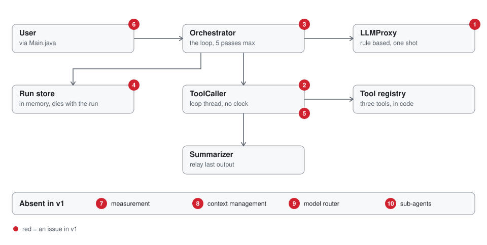
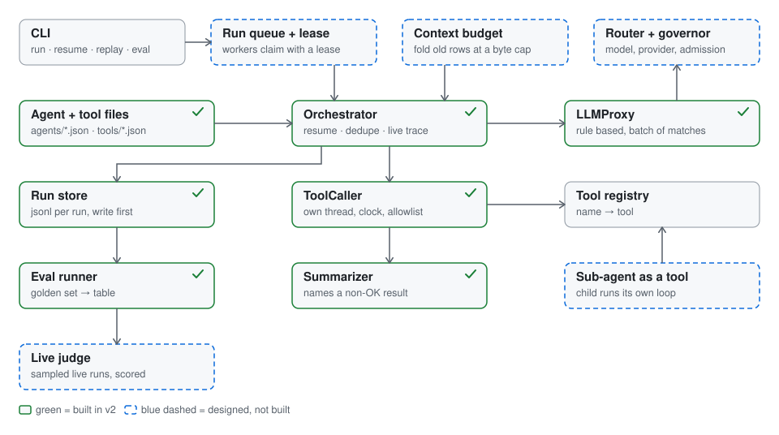
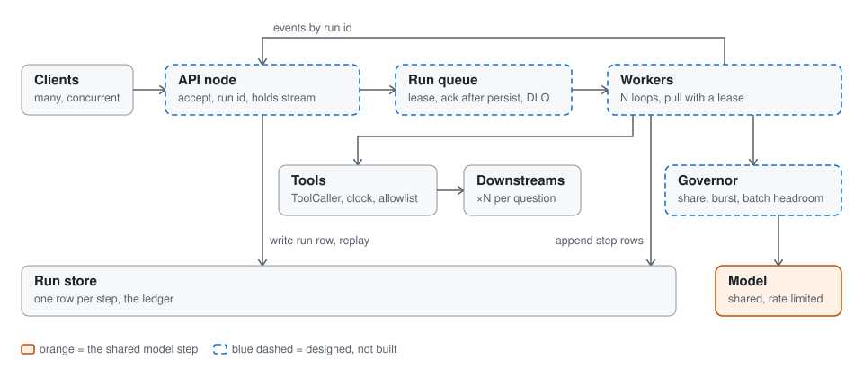
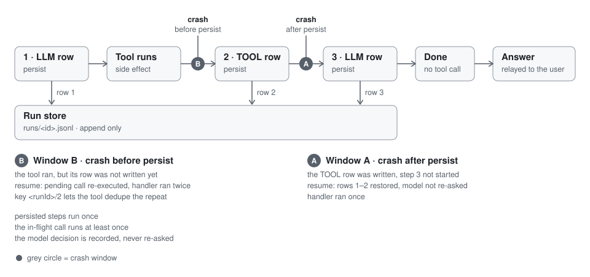
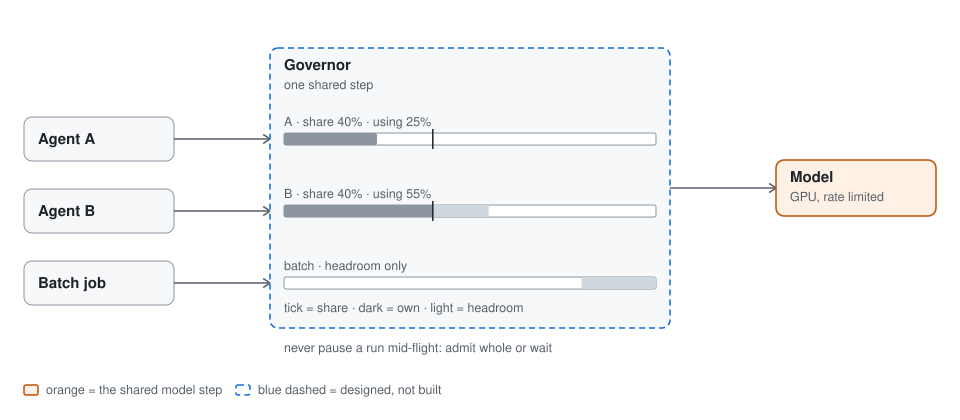
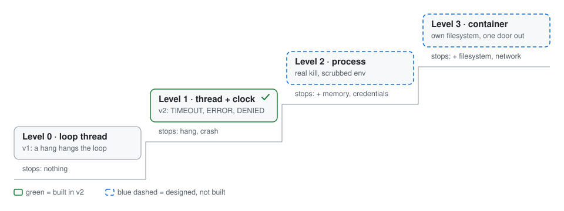
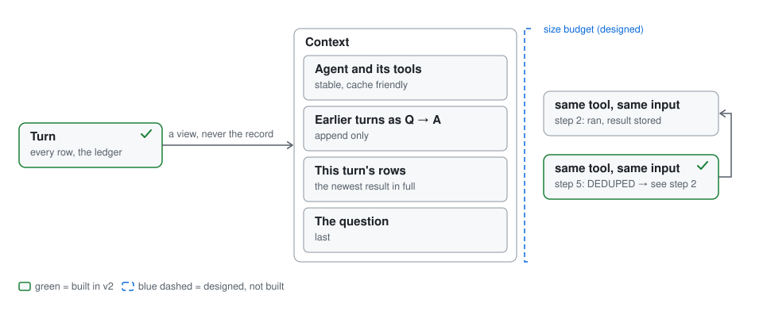
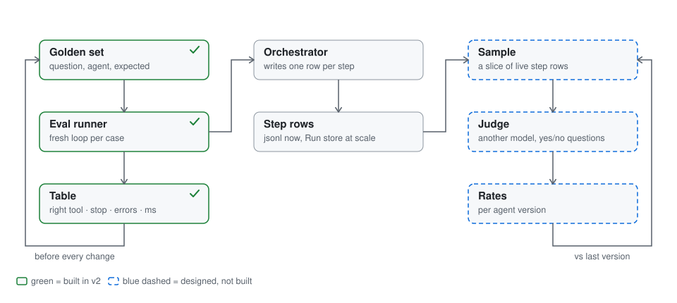

# Mini agent harness: the design

> [Position sentence, in your words: what you ran at scale, for how long, and that this harness is the small version of it.]

An agent harness is the loop between a model and the world: show the model the state, run the tool it asks for, feed the result back, stop when it says it is done. I built one live in the interview. This document is what I did with it afterwards: v1 as built, what was missing, v2 with the missing pieces that fit in one process, and then the part that matters, what breaks when this loop runs at scale and what I did about it on the platform I ran.

The six follow-ups from the brief are all here: durable runs (section 3.1, with `run --crash-after 1` and `resume`), sub-agents (3.4), parallel tool calls (2.5, `run --slow`), measuring the harness (section 5, `eval`), routing across providers (3.3), sandboxing (3.4, `run --agent chaos`). `./demo.sh` runs every command in this document in order, and `docs/demo-output.txt` is its saved output.

## 1 · v1: what I built live

One question, one tool call, one answer. The orchestrator builds the context, asks the model, gets either a tool call or done, runs the tool, records both as spans, and asks again. Five passes at most. The answer is the last tool output, relayed. The model is a stub: it matches a keyword and an id pattern in the question and names the matching tool.

It works, and it is the smallest thing that does. What it does not do:

1. Chain: the stub says done as soon as any tool has run.
2. Survive a hang: a tool runs on the loop thread with no clock, and a tool the agent never listed would still run.
3. Admit failure: the five-pass stop is silent, and a tool error comes back as the answer.
4. Survive its process: the record lives in memory. Kill the process and the run is gone.
5. Run two tools at once.
6. Be defined without code: the agent and its tools are hard-coded in the driver.
7. Measure itself.
8. Remember: the model sees only this turn.
9. Route: one model, no choice, no fallback.
10. Delegate: no sub-agents.

The brief's six follow-ups are items 4, 10, 5, 7, 9 and 2. v2 fixes everything that fits inside one process, which is items 2 through 8, and designs the rest.

## 2 · v2: what I added

**Agents and tools are files.** An agent is a JSON file: a name, the tools it may call, how many passes it gets, how long a tool call may take. A tool is a JSON file whose type picks the adapter; adding a tool is adding a file. The orchestrator is assembled from the agent file at start, and a tool the agent does not list is denied before it runs. `agents` and `tools` list what loaded.

**Every run is a log.** Each step is one line in `runs/<id>.jsonl`, written before the next step is taken. The same lines print live as the run goes, and `replay <id> <step>` prints them back from any step. That one log is what streaming, resume and eval all read.

**A run can be killed and resumed.** `run --crash-after 1` kills the process right after the model's decision is on disk; `resume <id>` picks the run up, runs the decided tool without asking the model again, and finishes. The other crash window, tool ran but its row never landed, is `--crash-before-persist`: resume runs the tool a second time, and the footer shows it. Both windows are in the demo. Section 3.1 is about why this is the hard part.

**A runaway tool is cut off.** Every tool call runs on its own thread with a clock. A hang becomes `TIMEOUT` after the agent's limit, a throw becomes `ERROR`, an unlisted tool is `DENIED`, and in all three cases the loop moves on and the answer says what happened. `run --agent chaos "Please hang while checking ORD-1"` shows it. This is a time boundary, not a sandbox; section 3.4 has the real levels.

**Independent tool calls run together.** When the model names two tools in one reply, both inputs are already known, so the harness runs them at the same time and writes their rows in the order they were asked, never the order they finished. `run --slow` adds simulated latency so the overlap is visible: two 300 ms tools, about 320 ms of wall time.

**Repeated calls are not repeated.** Several questions in one `run` form one conversation, and the model sees the earlier turns. A tool call with the same tool and the same input as an earlier one is not run again; its row points at the earlier result. Section 4.1 is where that rule comes from.

**The harness measures itself.** `eval` replays a golden set of twelve questions through the loop and scores it from its own rows: right tool, stopped because the model said done, errors surfaced as errors. Two cases fail on purpose. Section 5.

The model is still a stub. Nothing here needs a key or a network.

## 3 · At scale: what breaks, and what I did

The loop is a few hundred lines and it is not where the difficulty is. The difficulty is everything outside the process: the run has to outlive the process, the caller has to see progress, the model is one shared and rate-limited resource, and the tools are code nobody in the loop wrote. This is the section I would ask about.

### 3.1 Durability: the run must outlive the process

A turn is several seconds of model and tool calls. A deploy, a node rotation or an out-of-memory kill lands in the middle of one every day. If the run lived only in the process, the user gets nothing, and a blind retry may fire a write twice.

**On my platform.** The first version checkpointed the run only at wait points, the places where it had to stop anyway: a human approval, a timer, a long-running call. Between wait points the run lived in memory. A crash between them lost the run, and inside the agent loop the rule was simply "the turn is the unit; a crash means retry the turn". That was fine until it was not. The next version put a queue in front of the loop. Accepting a request now means writing the run row and returning its id; a worker claims the run from the queue with a lease, extends the lease while it is alive, writes each step before taking the next, and acknowledges the message only after the final step is persisted. If the worker dies, the lease expires, the run becomes visible again, and another worker resumes it from the last written step. After too many attempts the run goes to a dead-letter queue instead of looping forever. Resuming from the log was an opt-in per conversation, off by default, because of the one thing a log cannot fix.

That one thing is the in-flight call. If the process dies after a tool has done its work but before its row is written, resume runs the tool again. The contract is honest: persisted steps run exactly once, the in-flight call runs at least once. The harness supplies an idempotency key for every call, the run id plus the step that decided it, and a tool with a side effect dedups by that key. A tool that cannot gets a started-marker written before the call and a check on resume.

**In v2.** That is exactly the mechanism in the code: write before act, the model's decision recorded so it is never re-asked, the key on every call, and both crash windows in the demo. The queue and the lease are not in the repo, because they are infrastructure, and the mechanism is what has to be right.

**The choice you have to make.** A queue plus a step log, or a durable-execution engine such as Temporal. We built the queue shape; we never evaluated an engine, and the shape we scoped is the engine's shape. The trade is real either way:

| | Queue, lease, step log | Durable-execution engine |
|---|---|---|
| Idempotency of writes | the tool, by the harness's key | still the tool; the engine replays, it cannot un-fire a write |
| The lease | yours: heartbeat, ack after persist, sweep expired | the engine's task queue and timeouts |
| What you run | a queue and a table, which you already have | a new stateful service and its SDK |
| What the loop must obey | write before act | deterministic code; every model and tool call becomes an activity |

### 3.2 Streaming: the loop is the only producer

A user who sees nothing for twenty seconds assumes the system is dead, and a dropped connection must not throw away a running turn.

The model streams tokens, but its stream ends at the loop, because the loop has to see the whole reply to know whether it is a tool call or an answer. So the orchestrator, not the model, is the only producer the caller ever sees. That decides the design: give every run an id, append every step to a log that any node can read, and let a client that reconnects send the last step it saw and get the rest. A dropped connection is not a cancel; the run keeps going. Cancel is an explicit request, checked between steps, and a tool call already in flight finishes.

**On my platform.** The first shape streamed the turn over server-sent events on the same request that started it; the loop ran inside that request. A mid-turn drop lost whatever had not been persisted yet. We then split it: a thin API layer holds the connection and subscribes to the run's events by id, and the loop runs on queued workers behind it. Replay from the last seen id is the piece that closes the loop, and it is designed, not shipped.

**In v2.** The log is the stream. Rows print as they land, and `replay <id> <step>` is what a reconnecting client would receive. The HTTP endpoint is the next thing I would add, over the same log.

### 3.3 The model is the shared step: routing and capacity

Everything in the loop is cheap except the model call, and the model is one shared, rate-limited resource behind a GPU. If every agent calls the model its own way, nobody sees the fleet, nobody can meter it, and a burst from one consumer takes the others down.

The loop talks to one interface and never learns which model or provider answered. Behind that interface a router decides: which model (the agent pins one or names a class), which provider (allowed, then healthy, then within budget), and what to do on failure (one fallback that keeps the agent's policy, so a pinned model never silently becomes another, then a typed failure back to the loop). The row records model asked and model used, so the trace shows what really happened.

In front of the model sits a governor. Every consumer has a share of the capacity. Live calls are admitted up to that share, and a consumer may burst above it while there is free capacity. Batch work is admitted whole into free headroom and never paused mid-run; a run is the unit, so a job either waits or runs to the end.

**On my platform.** The first rate limit counted calls, not work. Too loose and we had incidents; too tight and we throttled live traffic while the GPU sat idle; batch had no door at all. The fix was a capacity meter in front of the shared model, the first shared service we ran: each consumer counts its own work per window against its share, the governor enforces the total, batch is admitted only into measured headroom, and the threshold is configurable and run conservative. Routing stayed inside one provider, by capacity and by pinned model or class. We never routed across providers by cost, and I would say that gap myself.

**In v2.** The seam exists, one interface and one row per call. The router and the governor are design.

### 3.4 Tools and agents: code the loop did not write

A tool can hang, throw, eat memory, read the disk, call the network, and read any credential the process holds. There are four levels of containment, and each costs a hop:

| Level | What it stops |
|---|---|
| On the loop thread (v1) | nothing: a hang hangs the loop |
| Own thread with a clock and an allowlist (v2) | a hang, a throw, an unlisted tool; not memory, disk, network or credentials |
| A separate process with a scrubbed environment | adds a real kill and no credential to steal |
| A container with one door out | adds its own filesystem, a memory cap, and network only through a door the harness owns |

**On my platform.** Agents that execute code run at the top level: one container per task, non-root, read-only root filesystem, a scrubbed environment, and two doors the platform owns. The model door on the loopback address signs requests with credentials the agent never sees. The egress door allows listed domains and injects the user's token, so the agent never holds it. The workspace is photographed before and after, and the diff is the verdict, not the agent's report. Two honest limits: the egress door is a switch set per environment, and a container is a resource boundary, not a security boundary against hostile code; for that you move to a micro-VM.

A sub-agent is the same idea from the other side: an agent exposed as a tool. The parent's own tool choice is the router, so delegating costs no extra model call; the child runs its own loop with its own tools, and only its answer comes back. Depth, passes and one budget shared down the tree are enforced by the orchestrator, never by the prompt. On another host the tool call becomes a network call and nothing else changes.

**On my platform.** I got this wrong first. I picked a framework's group chat as the default for multi-agent work without running the cost math. The next release showed up to twice the model calls, and every agent saw the whole conversation. I stopped new teams on it, and moving the known paths onto a fixed plan cut median latency by thirty to forty percent, measured in traces. The cost was a missed release, caught before production.

**In v2.** Level two containment is built. Sub-agents are design; the tool interface is already the seam.

## 4 · Performance: what the model sees

### 4.1 The context

A model call is stateless. On every pass the harness decides what the model reads, and that decision sets the cost of every later turn. Products like Codex compact their context inside their own harness; the API does not do it for you. This loop is that layer.

**On my platform.** A long-running agent got slower and more expensive on every turn. Replaying one recorded conversation showed latency and tokens climbing turn by turn; a model problem is flat, so the problem was ours. Identical tool results were being re-injected into the prompt, and the prompt was ordered volatile-first, so the provider's prefix cache never hit. The fix was three rules: order the prompt from stable to volatile and only ever append; make a repeated tool result a reference to the earlier one, not a copy; and when the budget overflows, fold the oldest rows into one summary once, rather than trimming the middle on every pass. Context fell to about a tenth, and the long-conversation turn went from twenty or thirty seconds to about six. Trim, a window and dedup shipped; the summary fold is designed.

**In v2.** The dedup rule and memory across turns are built. The budget and the fold are design.

### 4.2 Which tools to offer

Every tool definition the model is offered costs tokens on every call, and past a few dozen tools the model starts confusing look-alikes. My platform today hands the model every tool the agent imports on every call, and lists each tool server's catalog live on every turn, with no selection step. The proposal I have written for it: index every tool at registration, offer the model a few pinned tools plus one search tool, let it search when it needs a capability, and load the found definitions for the next pass. Under about ten tools, offer them all. v2 is under ten.

## 5 · Measuring the harness

A loop that runs is not a loop that works. "Is it good" is two questions and never one score: did the harness do its job, and was the answer right. The first is a fact in the rows: right tool, stopped because the model said done and not because the cap hit, errors surfaced as errors, how many passes, how many milliseconds. Code scores it exactly. The second needs a reference answer before you ship and a judge once you are live.

**In v2.** `eval` replays twelve golden cases through a fresh loop each, scores them from the rows, and prints one line per case. Two cases fail by design, "reorder ORD-1" picks the order tool and "track my parcel" matches nothing, because the stub matches substrings; they stay in so the number moves when the matcher improves. A test holds the harness scores at one hundred percent.

**On my platform.** Golden sets were recorded from real sessions with an expected trace, the tool calls and arguments, not just an expected answer, and replayed as a batch before every promotion. Once a model swap tripled the length of the retrieval queries while the answers stayed fine; only the expected trace caught it. A scheduled judge sampled production turns and published scores per agent. And the honest part: we stored the expected trace but the step scorer never shipped. The runner in this repo is that scorer.

Live needs three things this repo cannot hold: a store of every step row, a job that samples rows and asks a judge, and rates per agent version compared with the last version. The rows the harness already writes are the export; you build those three or you buy them.

## 6 · Honest limits

- The model is a stub; "right tool" means "right keyword", and the eval shows where that fails.
- A thread with a clock is not a sandbox.
- The log is durable for one process; the queue and the lease are drawn, not built.
- The in-flight tool call runs at least once.
- Tokens are not counted; passes and milliseconds are the bill.

## 7 · What I would build next, in order

1. The queue with a lease behind the run store, so a dead worker's run is picked up.
2. The streaming endpoint over the same log, so a reconnect replays from its last row.
3. The context budget with one fold, so tokens per turn stay flat.
4. The sampled judge over the step rows.
5. A real model behind the model interface; the eval then scores a real matcher.
