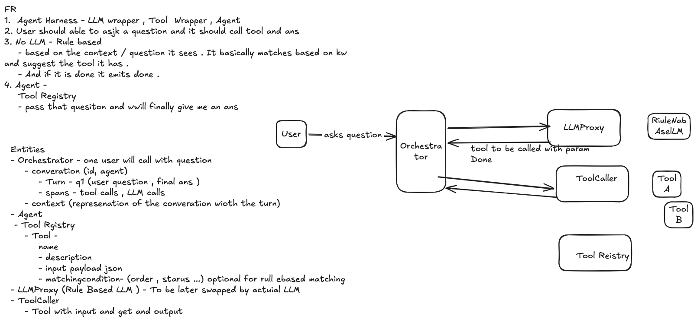

# Mini agent harness: the design

I built an agent platform that thousands of customers use in production, and ran it for several years. Everything on these pages is that experience, the platform I built and what it taught me, applied to a small harness.

One page that ties the pages together, in the order they were built: what was built live, what v2 adds, then the deep dives. Read this for the story, each page for the depth, `./demo.sh` for the proof (`docs/demo-output.txt` is its saved output). The brief is [PROBLEM.md](PROBLEM.md).

[1 · v1](#1--v1-what-i-built-live) · [2 · v2 HLD](#2--v2-the-harness-as-a-small-service) · [3 · Additional features](#3--v2-additional-features) · [4 · Durability](#4--durability) · [5 · Scaling](#5--scaling) · [6 · Performance](#6--performance) · [7 · Sub-agents](#7--sub-agents) · [8 · Measuring](#8--measuring-the-harness) · [9 · The picture at the end](#9--the-picture-at-the-end) · [10 · Next](#10--what-i-would-build-next-in-order)

## 1 · v1: what I built live

- The brief: `run(goal)`, a loop that hands the state to a model, runs the tool it asks for, feeds the result back, stops when the model says done; a stub model, no network. Then six follow-ups: durable runs, sub-agents, parallel tool calls, measuring the harness, routing across providers, sandboxing.
- What I drew and built in the hour: Orchestrator owns the loop; LLMProxy is the stub; ToolCaller and ToolRegistry run and hold the tools; Conversation, Turn, Span and Context are the state; a Summarizer relays the answer. One process, one question, one tool, done.
- What it could not do, and the follow-ups were about: a turn died with the process; nothing streamed; one tool at a time; no agent inside an agent; no way to say whether the loop did its job; the answer was the last tool's output.
- `v1/` is that code, frozen at tag `v1`, with its own [README](v1/README.md).

## 2 · v2: the harness as a small service

Page: [docs/V2_HLD.md](docs/V2_HLD.md)

- One service, two layers: the HTTP face and the loop. A turn is a job: `POST /runs` writes the turn row and answers with its id at once; the answer streams back over SSE as the steps and the tokens happen; `GET /turns/{id}` reads it after.
- Three tables, from the whiteboard: a conversation has turns, a turn is one job, a turn has spans. Every step is written to the store before the next one is taken.
- Agents and tools are files; the file's type picks the adapter; a builder would be its own service in front of this metadata.
- A question that needs several tool calls: sequential when the second lookup needs the first's result, parallel when the question names two independent things; the model decides which from what it has read.

## 3 · v2: additional features

Page: [docs/V2_FEATURES.md](docs/V2_FEATURES.md)

- What the loop already does beyond the picture, each with a run: the context is the memory, parallel tool calls, a clock on every tool call, the agent's tool list as the gate, the pass cap and the budget, chaining across passes, the answer.

## 4 · Durability

Page: [docs/DURABILITY.md](docs/DURABILITY.md)

- The split: the HTTP face and the loop become two processes with a queue between them, so a turn outlives the request that created it. A turn is a message; the visibility timeout is the lease; the worker extends it on every saved step and acks last.
- A dead worker's message comes back by itself; the next worker loads the saved rows and continues, mid-chain, without asking the model again for a decision it has.
- The contract: saved steps run once, the one call in flight at a crash at least once, so tool writes are idempotent on the key the harness gives them. Temporal is the step up; it was never evaluated, and the shape scoped here is its shape.
- What the POC runs: one build, two processes on one laptop, one SQLite file, the queue table standing in for SQS. Not containers.

## 5 · Scaling

Page: [docs/SCALING.md](docs/SCALING.md)

- The pods scale on load and on queue depth; nothing new there.
- The persistent connection: the queue cut the line between the pod holding the client and the pod running the turn. The loop is the producer of the run's stream; a Redis Stream per job id carries it to whichever API pod holds the connection, with replay from the last id; the store is the fallback. v2 has the same shape on one machine.
- The GPU, the one thing that does not autoscale: a governor in front of the shared model. On my platform I built the meter, saturation from calls and tokens because the provider's number comes late, the fair share per tenant for live, and the batch queue into the room; lending the room to live calls over their share is the design on the same number. Nothing of it is in v2, where the model is a stub.
- Tools and state: timeouts and limits on the downstreams, telemetry off the state store.

## 6 · Performance

Page: [docs/PERFORMANCE.md](docs/PERFORMANCE.md)

- Time and tokens, paid on every call. Built in v2: dedupe of tool results, and agent as a tool against multi-agent leakage. Design, from my platform: the prefix cache and the order of the prompt, and tools in hundreds with one search tool in the prompt and the catalog and the index behind it. The leak in the DAG is on the same page.

## 7 · Sub-agents

Page: [docs/SUBAGENTS.md](docs/SUBAGENTS.md)

- Three patterns I have run at scale: group chat or supervisor, which leaks the transcript and doubles the calls; agent as a tool, built here, where the child sees the goal and its own tools and the parent gets the answer; the DAG for a known sequence, best on a workflow engine.

## 8 · Measuring the harness

Page: [docs/EVAL.md](docs/EVAL.md)

- Two questions, never one score: did the loop do its job, was the answer right. A golden set with the expected trace before ship, built; a sampled judge live with named rates per agent version, designed. The harness scores are facts in the rows and code scores them exactly.

## 9 · The picture at the end

Three diagrams, in the order the pages added them, are the harness at scale: [the split and the queue](docs/durability.svg), [the stream across pods](docs/scaling-stream.svg), [the governor in front of the GPU](docs/scaling-gpu.svg). Everything built in v2 keeps its seam in that picture: the API layer, the loop in the worker, the run's stream, the store, the model interface, the tool registry.

## 10 · What I would build next, in order

1. The live loop of the eval: a sampled judge on a schedule, rates per agent version, a confirmed failure back into the golden set.
2. The Redis Stream per job id and the dead-letter queue, replacing the two stand-ins.
3. The tool catalog, the index and the search tool.
4. The governor in front of the model.
5. The DAG on a workflow engine for the sequences that are known up front.
6. A real model behind the interface, with tokens and cached tokens as columns in the eval.
