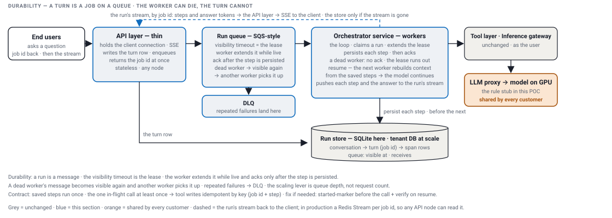
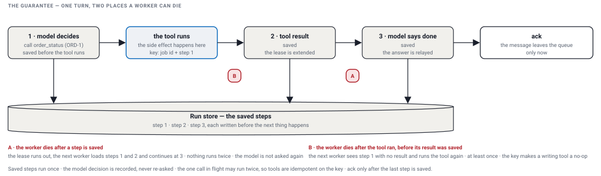

# Durability

[The issue](#the-issue) · [The design](#the-design) · [The guarantee](#the-guarantee) · [The choices](#the-choices) · [What I ran](#what-i-ran) · [The implementation](#the-implementation) · [Proof](#proof)

A turn (job id) becomes a message on a queue, a worker runs it, and when the worker dies the next one picks the turn up from its last saved step. This is how I envision it with SQS; the POC shows the bare minimum of the idea with a SQLite table standing in for the queue, the same three calls. Everything beyond that is out of scope here and says so. Every output below is from a real run of `./demo.sh`; the committed `demo-output.txt` is a later run, so its ids and timings differ, nothing else.

## The issue

- The agent is called; a turn is seconds of model and tool calls; the server dies in the middle of one.
- In v1 the loop lived in the request, so it died with the server, and the client's answer with it.
- The question is how the next server picks the turn up from where it stopped, without running the saved steps twice.

## The design



- **The split.** The HLD drew the HTTP face and the loop as one service. Here they become two processes with a queue between them: the API process takes the request, a worker process runs the turn. A turn is seconds of model and tool calls and has to outlive the request that created it, and the two scale on different signals, requests on one side and queue depth on the other.
- **End users → API layer**: the question comes in; the API writes the turn row (`QUEUED`) and a message on the queue in one transaction, and returns the turn's id, the job id, at once. No loop runs in this process.
- **Run queue**: the message is the turn. `receive` hides it for the visibility window, and that window is the lease: whoever holds it is the only worker on the turn.
- **Workers**: a worker receives, claims the turn row (`RUNNING`, its process id, attempts + 1) and runs the loop; each step is written to the store before the next one, and each written step extends the lease.
- **Ack**: only after the last step is saved and the turn row says `DONE` with the answer does the worker delete the message.
- **Dead worker**: no ack, the lease runs out, the message is visible again; the next worker receives it, finds the saved steps, and resumes from the last one, so the model is asked only for what comes next.
- **DLQ** (dead-letter queue): after N receives the message goes to a dead-letter queue instead of looping forever. Out of scope for the POC.
- **The stream back to the client**: the worker pushes each step and each piece of the answer to the run's stream as they happen; the API node holding the connection forwards it as Server-Sent Events (SSE), so it does not care which worker is on the turn. The store is read only if the stream is gone: the saved rows, once.
- **The call in flight**: a worker that dies after a tool did its work and before the row landed leaves one call that runs twice; every call carries a key (job id + deciding step), and a tool that writes ignores the repeat.

| table | columns | what it is for |
| --- | --- | --- |
| `conversation` | `id` · `agent` · `created_at` | one row per conversation: who talks to which agent |
| `turn` | `id` (the job id) · `conversation_id` · `question` · `answer` · `status` (QUEUED · RUNNING · DONE · FAILED) · `claimed_by` · `attempts` · `created_at` · `updated_at` | one row per turn: where it is, who has it, how many workers tried, the answer |
| `span` | `turn_id` · `span` · `pass` · `kind` · `request` · `response` · `status` · `ms` · `attrs` (JSON) · key (`turn_id`, `span`) | one row per saved step: what resume and the stream read |
| `queue` | `turn_id` · `visible_at` · `receives` | the message: hidden until `visible_at`, counted on every receive |

Out of scope for the POC, in the design only: the dead-letter queue, a sweeper for jobs that never finish, more than one worker process at a time on one file.

## The guarantee

What the queue promises, and what it cannot, on one turn.



| What | Guarantee | What makes it true |
|---|---|---|
| a step that is saved | runs once | resume starts after it |
| the model's decision | recorded, never asked twice | it is saved before the tool runs |
| the one call in flight when the worker dies | may run twice | the harness cannot know whether the tool did its work, so it runs it again: at least once |
| a tool that writes | no double effect | it is idempotent on the key the harness gives it, job id plus step |
| the whole turn | finishes, or is handed to the next worker | ack only after the last step is saved; no ack, the lease runs out |

- Window A, the worker dies after a step is saved: the next worker continues after that step. Nothing runs twice, the model is not asked again.
- Window B, the worker dies after the tool ran but before its result was saved: the next worker runs the tool again. The key makes a writing tool a no-op; a read just repeats.
- So the queue is at-least-once, and the tools carry the rest. That is good enough for production; it is what I ran.
- Temporal keeps this bookkeeping for you: a completed step is in its history and never re-runs, and retries and timers are its. The side effect inside a step is still at least once, so it still asks for idempotent activities. The contract is the same; what you buy is that the bookkeeping is no longer yours to get right.

## The choices

| option | how it works | what you get | what it costs |
| --- | --- | --- | --- |
| a job table polled by workers | workers `SELECT` the oldest `QUEUED` row and `UPDATE` it to `RUNNING` with their name; a stuck row is found by its age | nothing new: the table you already have | the claim race, the "is it stuck" clock and the sweeper for orphans are all yours to write and get right |
| a queue with a visibility timeout | the three calls of SQS (Amazon's Simple Queue Service): `receive` hides the message for a window, `extend` pushes the window, `ack` deletes; no ack and the window runs out on its own | the orphan problem is solved by the protocol: a dead worker's message comes back by itself, counted, and a limit sends it to the DLQ | the message and the job row are two things to keep in step; the one call in flight at a crash can run twice |
| Temporal | a workflow engine replays the turn's history to rebuild its state; activities retry by policy, timers and signals are built in | exactly-once workflow steps, retries, timers, long waits, versioning, a UI | a cluster to run, a programming model to learn, the loop rewritten as a workflow |

I pick the queue: the simplest thing that works at the scale I ran, and the lease and the redelivery come from the protocol instead of from code I have to get right. Temporal is the step up: its own infrastructure and a programming model, in return for replay, timers and long waits. If the scale or the workflow shapes outgrow the queue, that is where I go.

## What I ran

- The first version checkpointed the run only at wait points: an approval, a timer, a long call. Between them the run lived in memory, and a crash between them lost it.
- The next version put an SQS-style queue with a visibility timeout in front of the loop: the worker extends it while the run is live, acks only after the step is persisted, a dead worker's message becomes visible again and another pod picks it up, repeated failures go to the DLQ. The scaling lever became queue depth, not request count.
- Resume is an opt-in log of completed tool calls per conversation: the new pod rebuilds the context from it and the model continues.
- The contract, said as a contract: completed tool calls run once, the one in-flight call at least once, so tool writes are idempotent by key; the fix if that is ever not enough is a started-marker before the call and a check on resume.
- We never evaluated Temporal; with hindsight durability was the real hard problem, and I would put a durable-execution engine under the loop.

## The implementation

What runs here, said plainly:

- One jar, two commands. `serve` is the API process; `worker` is the orchestrator process. Two JVM processes on one laptop, one SQLite file between them.
- Not containers, not pods. A process exiting stands in for a pod dying, a second process for the next pod, the `queue` table for SQS, the file for the tenant database. The one network call between the two is the worker pushing the run's stream to the API over HTTP; the API holds that stream in memory, standing in for the Redis Stream.
- One worker at a time on the file. More than one worker process at once is out of scope here: SQLite has one writer, and the three calls would move to SQS before a second worker is needed.
- The queue is one table in the same file as the runs, and `RunQueue` is the three calls on it; swap the table for SQS and the three calls are the same.

<details><summary>the three SQL statements of the queue: receive, extend, ack</summary>

```java
public Optional<Message> receive(long visibilityMs) {                    // the oldest visible message, now hidden and counted
    """UPDATE queue SET visible_at = ?, receives = receives + 1
       WHERE turn_id = (SELECT turn_id FROM queue WHERE visible_at <= ? ORDER BY rowid LIMIT 1)
       RETURNING turn_id, receives"""                                   // ? = now + visibilityMs, now
}
public void extend(String turnId, long visibilityMs) {                    // the worker is alive and still on it
    "UPDATE queue SET visible_at = ? WHERE turn_id = ?"                   // ? = now + visibilityMs
}
public void ack(String turnId) {                                          // the turn is done
    "DELETE FROM queue WHERE turn_id = ?"
}
```

One `UPDATE` both finds the oldest visible message and hides it, so two workers asking at the same moment cannot both get it; `extend` and `ack` are one statement each. The database plumbing around each statement is left out here; `RunQueue.java` has it.
</details>

The worker is the loop around those calls: receive, claim, run or resume, ack last.

<details><summary>the worker loop</summary>

```java
Optional<RunQueue.Message> next = queue.receive(visibilityMs);
if (next.isEmpty()) { return false; }                                     // loop() waits 500 ms and asks again
String turnId = next.get().turnId();
int attempt = store.claim(turnId, name);                                   // RUNNING, claimed_by, attempts + 1
TurnRow turn = store.turn(turnId);
List<Span> saved = store.load(turnId);
// inside orchestrator(turn): a listener that runs after every written row:
//   span -> { queue.extend(turn.id(), visibilityMs); print.on(span); }
String answer = saved.isEmpty()
        ? orchestrator(turn).start(turnId)                                 // a fresh turn
        : orchestrator(turn).resume(turnId);                               // a dead worker's turn, from its last row
queue.ack(turnId);                                                         // the last thing
```

The store says whether a worker died on this job (it has steps), so resuming is the normal path, not a special one. The listener runs after each row is in the store, so the lease moves with the saved work; the ack comes last.
</details>

## Proof

The demo, the bare minimum, two processes on one laptop: submit, a worker process that dies after its second row, two seconds for the lease to run out, a second worker process resuming from that row and continuing the chain, the turn DONE over HTTP.

<details><summary>proof: the crash, the expired lease, the resume</summary>

```
(submit writes the turn row QUEUED and its queue message without HTTP, and comes back with the id:)
$ java --enable-native-access=ALL-UNNAMED -cp "target/classes:target/lib/*" harness.cli.Main submit --agent support "What is the status of order ORD-1?"
submitted r-26e4 · QUEUED in harness.db · agent support · "What is the status of order ORD-1?"
$ curl -s http://localhost:62588/turns/r-26e4
{
  "id" : "r-26e4",
  "conversationId" : "c-adda",
  "agent" : "support",
  "question" : "What is the status of order ORD-1?",
  "answer" : null,
  "status" : "QUEUED",
  "claimedBy" : null,
  "attempts" : 0,
  "createdAt" : 1792045734821,
  "updatedAt" : 1792045734821,
  "spans" : [ ]
}
(a worker takes it with a 2000 ms lease and dies right after its 2nd row is persisted: exit 3, no ack; the order lookup ran once in this process, so the crash line counts order_status=1)
$ java --enable-native-access=ALL-UNNAMED -cp "target/classes:target/lib/*" harness.cli.Main worker --once --crash-after 2 --visibility-ms 2000 --api http://localhost:62588
worker pid 48822 · lease 2000 ms · once · streams to http://localhost:62588 · harness.db
received r-26e4: attempt 1 · agent support · "What is the status of order ORD-1?"
  1  LLM   pass 1 -> ToolCall[toolName=order_status, input={orderId=ORD-1}]  [OK 2 ms]
  2  TOOL  order_status {orderId=ORD-1} -> Order ORD-1: SHIPPED, shipment SHP-1  [OK 0 ms]
crash: exit 3 right after row 2 of turn r-26e4 was persisted (simulated) · handler calls: order_status=1
(process exited with code 3; the turn row says RUNNING, the message is still queued but hidden until the lease runs out)
$ sleep 2
(the lease has run out, so the next worker receives the same message again and resumes from the last saved step: it does not run the saved order_status call again, it continues the chain at pass 2, reads SHP-1 in the saved result, asks for the shipment and says done; its footer counts shipping_status=1 only, because order_status ran in the process that died:)
$ java --enable-native-access=ALL-UNNAMED -cp "target/classes:target/lib/*" harness.cli.Main worker --once --api http://localhost:62588
worker pid 48826 · lease 2000 ms · once · streams to http://localhost:62588 · harness.db
received again: attempt 2, lease had expired · r-26e4 resumes from step 2
  3  NOTE  resumed from step 2  [OK 0 ms]
  4  LLM   pass 2 -> ToolCall[toolName=shipping_status, input={shipmentId=SHP-1}]  [OK 1 ms]
  5  TOOL  shipping_status {shipmentId=SHP-1} -> Shipment SHP-1: IN TRANSIT, arriving 2026-10-16  [OK 0 ms]
  6  LLM   pass 3 -> Done[]  [OK 0 ms]
answer: Order ORD-1: SHIPPED, shipment SHP-1
Shipment SHP-1: IN TRANSIT, arriving 2026-10-16
done r-26e4 · 6 spans · 114 ms · DONE in harness.db · acked · handler calls: shipping_status=1
(the API reads the same rows, whoever wrote them: DONE, attempt 2, claimed by the second worker's pid, all six spans, the answer with both lines)
$ curl -s http://localhost:62588/turns/r-26e4
{
  "id" : "r-26e4",
  "conversationId" : "c-adda",
  "agent" : "support",
  "question" : "What is the status of order ORD-1?",
  "answer" : "Order ORD-1: SHIPPED, shipment SHP-1\nShipment SHP-1: IN TRANSIT, arriving 2026-10-16",
  "status" : "DONE",
  "claimedBy" : "48826",
  "attempts" : 2,
  "createdAt" : 1792045734821,
  "updatedAt" : 1792045738766,
  "spans" : [ {
    "turnId" : "r-26e4",
    "span" : 1,
    "pass" : 1,
    "kind" : "LLM",
    "request" : "pass 1",
    "response" : "ToolCall[toolName=order_status, input={orderId=ORD-1}]",
    "status" : "OK",
    "ms" : 2,
    "attrs" : {
      "question" : "What is the status of order ORD-1?",
      "tool" : "order_status",
      "orderId" : "ORD-1"
    }
  }, {
    "turnId" : "r-26e4",
    "span" : 2,
    "pass" : 1,
    "kind" : "TOOL",
    "request" : "order_status {orderId=ORD-1}",
    "response" : "Order ORD-1: SHIPPED, shipment SHP-1",
    "status" : "OK",
    "ms" : 0,
    "attrs" : {
      "tool" : "order_status",
      "orderId" : "ORD-1",
      "key" : "r-26e4/1"
    }
  }, {
    "turnId" : "r-26e4",
    "span" : 3,
    "pass" : 1,
    "kind" : "NOTE",
    "request" : "resumed from step 2",
    "response" : "",
    "status" : "OK",
    "ms" : 0,
    "attrs" : { }
  }, {
    "turnId" : "r-26e4",
    "span" : 4,
    "pass" : 2,
    "kind" : "LLM",
    "request" : "pass 2",
    "response" : "ToolCall[toolName=shipping_status, input={shipmentId=SHP-1}]",
    "status" : "OK",
    "ms" : 1,
    "attrs" : {
      "question" : "What is the status of order ORD-1?",
      "tool" : "shipping_status",
      "shipmentId" : "SHP-1"
    }
  }, {
    "turnId" : "r-26e4",
    "span" : 5,
    "pass" : 2,
    "kind" : "TOOL",
    "request" : "shipping_status {shipmentId=SHP-1}",
    "response" : "Shipment SHP-1: IN TRANSIT, arriving 2026-10-16",
    "status" : "OK",
    "ms" : 0,
    "attrs" : {
      "tool" : "shipping_status",
      "shipmentId" : "SHP-1",
      "key" : "r-26e4/4"
    }
  }, {
    "turnId" : "r-26e4",
    "span" : 6,
    "pass" : 3,
    "kind" : "LLM",
    "request" : "pass 3",
    "response" : "Done[]",
    "status" : "OK",
    "ms" : 0,
    "attrs" : {
      "question" : "What is the status of order ORD-1?"
    }
  } ]
}
```
</details>

- The first worker's last line is row 2 and `exit 3`, and its crash line counts `order_status=1`. The second worker's first line is `received again: attempt 2, lease had expired`, its first new row is step 3, `resumed from step 2`, and it continues the chain: it reads SHP-1 in the saved result, asks for the shipment at pass 2, and says done at pass 3. Its footer counts `shipping_status=1` only: the saved order lookup did not run again, and the model was not asked again for the decision it had already recorded.
- `GET /turns/{id}` after that: `DONE`, `attempts 2`, `claimedBy` is the second worker's pid, six spans and the answer with both lines; the API read the rows and never knew which process wrote which.
