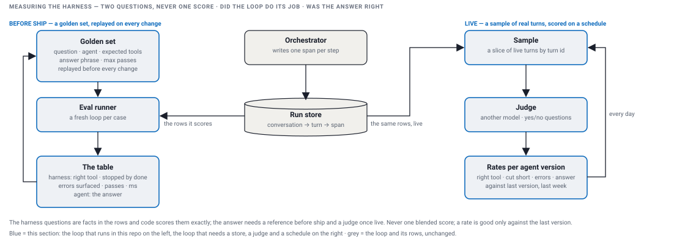

# Measuring the harness

[The issue](#the-issue) · [Your own rows, or a product](#your-own-rows-or-a-product) · [The design](#the-design) · [The choices](#the-choices) · [What I ran](#what-i-ran-on-my-platform-in-production) · [The implementation](#the-implementation) · [Proof](#proof) · [Live, at scale](#live-at-scale-where-the-rows-go-and-who-judges) · [What v2 implements](#what-v2-implements)

An agent can be up, fast, error-free, and completely wrong. Measuring a harness means two questions, asked separately and never blended into one score: did the loop do its job, and was the answer right. Every output below is pasted from `demo-output.txt`, which `./demo.sh` writes.

## The issue

- The harness does not own any one agent's answer. It owns that the loop did its job, and that nothing moved when the harness changed, for every agent on it. That has to be measurable without reading each agent's prose.
- The two questions get mixed. "Right tool, stopped by done, errors surfaced, how many passes, how long" are facts about the loop. "Was the answer right" is about the agent. One blended number cannot say which moved, since when, or who owns the fix.
- Before ship there is an answer key. Live there is none: the only things that can be measured on real traffic are the facts in the rows and whether the answer stuck to what the tools returned.

## Your own rows, or a product

- At scale the question is one view over every agent of every tenant: the rates per agent version, a click from a rate to the exact turn, the judge's input. A product such as LangSmith sells exactly that: traces, scores, datasets and the screens.
- The same can be built over your own rows: the loop writes every step, a scheduled job scores a sample, the scores sit beside the rows, a column store answers the questions across agents. v2 does the before-ship half of this over its own rows; my platform did both halves over its rows.
- What decides is where the text may live. In your own store when the contract says the text stays with the tenant; in the product when it may leave. The loop does not change either way: the listener that gets every step is the seam.

## The design



- **Two loops over the same rows.** Before ship: a golden set replayed before every change. Live: a sample of real turns scored on a schedule. Both read the step rows the loop writes anyway; neither sits in the request path.
- **The golden set holds the expected trace, not just the expected answer.** A case is a question, an agent, the tools that must be called, a phrase the answer must contain, a pass cap. That is the only way to catch a wrong tool call that still yields a plausible answer.
- **The harness questions are facts in the rows, and code scores them exactly.** Right tool, stopped by done, errors surfaced, passes, time, tokens. No model, no reference, every trace.
- **The answer needs a reference before ship and a judge live.** Before ship: a phrase or an exact value from the key, or a judge with the reference in hand. Live: a judge without a reference measures grounded and relevant, never right. Correctness lives in the golden set.
- **Code first, judge last.** A judge answers one yes/no question per check with a one-line reason, never a 1 to 10 score; it is a different model from the agent's; its version is pinned on every score; it is checked against a few human labels a week.
- **Score per turn, never per step.** A step is one model call or one tool call; "did it do what was asked" has no meaning at that grain. A conversation is scored once it goes quiet.
- **One named rate per agent and version.** Scores become rates per agent, version and tool, compared to the previous version, last week, or the owner's target. Alert on the one rate that moved. A finding is the rate, the slice, a few example traces, a cause as a hypothesis, and a next step with an owner.
- **The loop closes on a golden case.** A confirmed live failure becomes a new case, replayed before every release after.

## The choices

| Option | How it works | What you get | What it costs |
|---|---|---|---|
| expected answer only | a case is a question and an answer phrase | cheap to write | a wrong tool with a plausible answer passes |
| expected trace too | the case also names the tools that must run; the scorer reads the rows | a tool-choice regression fails on its own, before anyone reads prose | the trace must be graded loosely, as a set, or it goes stale when tools change |
| judge every request, in the request path | an extra model call on each turn | a verdict per conversation | latency and a bill on every turn; nothing to compare against |
| a sampled batch judge | a scheduled job over a share of turns, a cap on spend | a trend per agent version at a bounded cost, zero added latency | minutes to hours late; rare failures need a second, triggered stream |
| one blended health score | quality, satisfaction, reliability, performance weighted into one number | one number to alert on | it cannot say which rate moved, since when, or who owns it |
| named rates per agent and version | every check is its own rate, compared to the last version and last week | the finding names the slice and the owner | more alerts, no single dashboard number |

I pick the expected trace, the sampled judge and named rates. I designed a blended score once and threw it away: a number that cannot say what moved is not actionable. The harness scores are code over the rows, and the judge is spent only where words must be read.

## What I ran, on my platform in production

- Before ship: the teams that own the agents recorded golden sets from real sessions, the expected tool calls stored next to the expected answer, and we replayed them before a change went out, on the answer only: the tool-choice check in the bullet below never shipped.
- Live: a scheduled judge scored a sample of real turns per agent and published the trend per agent version. When a model switch broke agents in subtle ways, the trend broke, and we had it in days instead of weeks of anecdotes.
- We took the important decisions on those numbers. Critical features and model changes shipped with confidence because the golden sets and the live judge said quality held; without them every change would have been a guess and an argument. The context fixes on the performance page shipped that way: the tenants' golden sets flat, the cost down.
- It caught the big ones early, and they were about cost and time as much as correctness. The multi-agent pattern we started with burned far more tokens than anyone expected, up to twice the model calls per hop; the numbers showed it one release in, and that is what let me stop it. The same numbers put the context growth on a chart before customers did.
- What was missing: the expected tool calls were recorded, but the check that compares them with the tools called never shipped, and tool errors were never counted. Both are plain code over rows we already had: the cheapest checks, and the ones missing.
- The finding that made all of this real I reached by hand. I plotted prompt tokens per turn from the rows and saw a conversation at about 175k tokens by turn sixteen, most of it ten copies of one tool result. The context fixes that followed cut the token cost by about eighty percent and the context to about a tenth, with the golden sets flat. That is the check I would automate first.

## The implementation

v2 builds the before-ship loop: a golden set, a runner, a table. A case is one line of JSON:

```json
{ "question": "What is the status of order ORD-1?", "agent": "support",
  "expectTools": ["order_status", "shipping_status"], "answerContains": "SHIPPED", "maxPasses": 3 }
```

The runner gives every case a fresh loop over its own in-memory store, runs it, and scores the rows the loop wrote, not the answer alone. The harness scores are exact; the agent score is a phrase check standing in for a judge with the reference.

<details><summary>the scorer</summary>

```java
public static CaseResult score(GoldenCase golden, List<Span> rows, String answer, long ms) {
    Set<String> tools = new TreeSet<>();
    boolean stoppedByDone = true;
    boolean errorsSurfaced = true;
    int passes = 0;
    for (Span row : rows) {
        if (row.kind() == Span.Kind.LLM) {
            passes++;
        }
        if (row.status() == Span.Status.CUT_SHORT) {
            stoppedByDone = false;
        }
        if (!row.kind().isCall() || row.status() == Span.Status.DEDUPED) {
            continue;
        }
        tools.add(row.attrs().getOrDefault("tool", "?"));
        if (row.status() != Span.Status.OK && !answer.contains(row.status().name())) {
            errorsSurfaced = false;
        }
    }
    boolean toolChoice = tools.equals(new TreeSet<>(golden.expectTools()));
    boolean answerOk = normalize(answer).contains(normalize(golden.answerContains()));
    return new CaseResult(golden, tools, toolChoice, stoppedByDone, errorsSurfaced, answerOk, passes, ms, answer);
}
```
`tool_choice` is the set of tools that ran against the set expected, a repeat excluded. `stopped_by_done` is no `CUT_SHORT` row. `errors_surfaced` is every non-OK call named by its status in the answer. `answer` is the phrase, normalized. The table is one line per case and a footer with the harness scores and the agent score, apart.
</details>

`POST /evals` runs the set in the server and returns the table; `eval` on the command line prints the same.

## Proof

<details><summary>proof: the golden set from the `eval` command, two FAILs left in on purpose; `POST /evals` returns the same lines</summary>

```
 1  PASS  support    What is the status of order ORD-1?                      ran order_status,shipping_status  3 passes     11 ms
 2  PASS  support    Where is my shipment SHP-1?                             ran shipping_status              2 passes      0 ms
 3  PASS  support    Is product PRD-2 available?                             ran stock_status                 2 passes      0 ms
 4  PASS  support    What is the status of order ORD-99?                     ran order_status                 2 passes      0 ms
 5  PASS  support    What is the weather today?                              ran no tool                      1 pass       0 ms
 6  PASS  chaos      Please hang while checking ORD-1                        ran hang_forever                 2 passes   1009 ms
 7  PASS  chaos      boom                                                    ran throw_boom                   2 passes      0 ms
 8  PASS  support    Status of order ORD-2 and is product PRD-1 available?   ran order_status,stock_status    2 passes      5 ms
 9  PASS  inventory  How many PRD-1 do we have in stock?                     ran stock_status                 2 passes      0 ms
10  PASS  inventory  refund order ORD-1                                      ran no tool                      1 pass       0 ms
11  FAIL  support    reorder ORD-1                                           ran order_status,shipping_status  3 passes      0 ms  tool_choice: expected [] got [order_status, shipping_status]; answer: expected "No tool" got "Order ORD-1: SHIPPED, shipment SHP-1 | Shipment SHP-1: IN TRANSIT, arriving 2026-10-16"
12  FAIL  support    track my parcel SHP-3                                   ran no tool                      1 pass       0 ms  tool_choice: expected [shipping_status] got []; answer: expected "DELIVERED" got "No tool for this question."
13  PASS  support    Where is my order ORD-3?                                ran order_status,shipping_status  3 passes      0 ms
harness: tool_choice 11/13 · stopped_by_done 13/13 · errors_surfaced 13/13 · p50 0 ms | agent: answer 11/13
```
The two failures are the stub's known limits, left in so the table has something to say: "reorder" contains the order tool's keyword and runs it; "track my parcel" contains none of the shipping tool's keywords, "tracking" among them. Both fail on `tool_choice` first, the harness column, before the answer column says anything; that is the point of the expected trace. Cases 1 and 13 are the chain: two tools, three passes, and the answer with both lines.
</details>

## Live, at scale: where the rows go and who judges

- The live loop reads every step of every agent across every tenant. The step row is on the request path and is read by id; a question across the fleet scans billions of rows and groups by anything. One store cannot be both, so the rows are copied into a second, column-shaped store, joined by the same ids.
- That store holds one wide row per step with every dimension on it, tenant, agent, version, model, tokens, cost, latency, status, and the text as a pointer. Any question is one query, then one click into the exact turn. Scores sit beside the rows. A column store such as ClickHouse, or a product such as LangSmith on top of one.
- The loop writes each step once. A collector takes the span out of the process, strips identifiers, and fans it out. The words stay in the tenant's store and are fetched by id when a person or the judge needs them; the judge runs inside that boundary and writes back only a score.
- On my platform, in production: every step was a row per tenant with the full text, built for debugging one conversation, not for questions across the fleet. "The GPU went up, who?" was hours of digging through logs, because no row had a column to group by. What I would do from day one: one trace id on every row, metric, log line and score, and a skinny span store beside the state database.
- None of this is in v2. The seam is the listener that gets every step.

## What v2 implements

| Part | In v2 | Design only |
|---|---|---|
| the golden set with the expected trace | built: `evals/golden.json`, tools that must run, a phrase, a pass cap | recording cases from real sessions |
| the harness scores from the rows | built: tool choice, stopped by done, errors surfaced, passes, time | tokens and cached tokens, once a real model is behind the interface |
| the agent score | a phrase check against the key | a judge with the reference; a rubric for prose |
| the table | built: one line per case, the harness footer and the agent score apart | rates per agent version, compared to the last version and last week |
| the live loop | | a sampled judge on a schedule, grounded and relevant without a reference, a finding with a slice and an owner, a confirmed failure back into the golden set |
