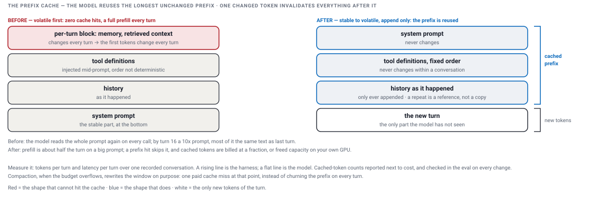
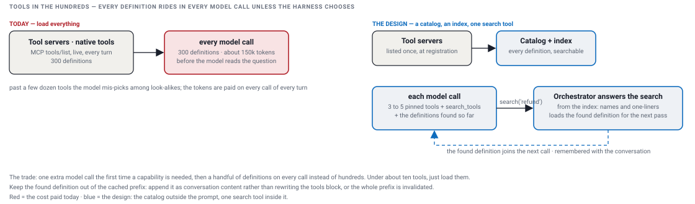
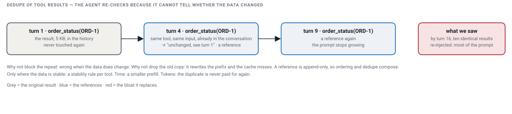
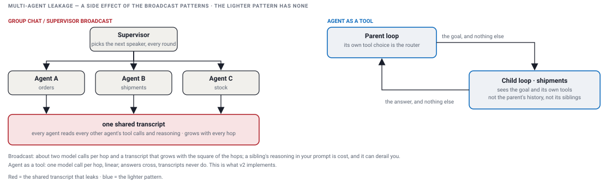

# Performance: time and tokens

[The prefix cache](#the-prefix-cache) · [Tools in hundreds · Progressive tool discovery](#tools-in-hundreds--progressive-tool-discovery) · [Dedupe of tool results](#dedupe-of-tool-results) · [Multi-agent leakage](#multi-agent-leakage) · [What v2 implements](#what-v2-implements)

- Performance in an agent loop is not only time. Every model call reads the whole prompt again, so a prompt that grows is paid twice on every turn: once in seconds, once in tokens.
- The four optimizations below each cut both, and each is measured the same way: replay one recorded conversation, plot latency and tokens per turn, and check function and cost in one run.

## The prefix cache

- The model server remembers what it has already read. If the next call starts with exactly the same text, it skips that part and reads only what is new.
- One changed character means everything after it is read again.
- So put what never changes first: the system prompt, then the tool definitions in a fixed order. Then the conversation as it happened. The new question last. Never edit earlier text; only add to the end.
- Two things break it. Cutting old text out of the middle on every turn: the text changes every turn, so nothing is reused. Summarizing old turns: that changes the text too, so do it rarely, at a checkpoint, and pay one full read then.
- The remembered state sits on the one model server that read it. The gateway has to send a conversation back to the same server, or there is nothing to reuse.
- On my platform, in production, the order was inverted: the per-turn block first, tools injected in the middle in a changing order, the system prompt last. The first characters changed every turn, so nothing was ever reused. Nothing looked wrong from the outside; you only see it if you measure tokens and latency per turn.

**Time and tokens**

- A hit skips most of the reading: about half the turn on a big prompt.
- Cached tokens are billed at a fraction of the price; on your own GPUs the reading capacity is freed.
- Measure cached tokens over prompt tokens per call, next to cost, and make it a column in the eval, so a change that breaks the order shows up as a cost before it ships.

**What I ran, on my platform in production**

- Every question in a conversation was slower and more expensive than the one before.
- Replaying one recorded conversation and plotting latency and tokens per turn gave a rising line. A model problem is flat, so the problem was in the platform.
- The reorder was done once, in the shared context builder; no team changed its agent.
- The cached-token count, which the provider did not return at first, was obtained and reported next to cost.
- With the other context fixes, the long-conversation turn went from twenty or thirty seconds to about six, and context to about a tenth, with function held on the golden set.
- Trim, a window and dedupe shipped; summary compaction at checkpoints is the direction.

## Tools in hundreds · Progressive tool discovery

- The issue. A tool server with sixty objects and five verbs each is three hundred tools. Every definition rides in every model call, about five hundred tokens each, so the model reads about 150k tokens before it reads the question, on every call of every turn. Past a few dozen it also mis-picks among look-alikes.
- The design in my words: I have this search tool which knows what the tools for this agent are and exposes a search instead. The LLM calls this, and I have the intelligence to return the tool definition as output. The LLM sees that and calls the actual tool, and then we go call MCP.
- ⓪ Once, when a server is registered: list its tools, keep the full definitions in the catalog, index name, description and parameter names. Never on a turn.
- ① ② The model sees search_tools plus three to five pinned tools. It has no refund tool, so it searches, and its query carries the intent: "refund an order".
- ③ The orchestrator answers the search itself, in four steps, with no model call and no server call: take the query → match it to a tool → pull the full definition, parameters included, from the catalog → send it back in the next call's tools, and keep the name in loaded_tools so the next turn needs no search.
- ④ ⑤ The model now has the parameters and calls the real tool. ⑥ The loop routes it to the tool client, exactly as today. ⑦ ⑧ The answer.
- What does the matching: a semantic plus keyword index over name and description, milliseconds, no model. If the top few are often wrong, a decision model or a small LLM reranks them; measured on a golden set of question → expected tool. Whatever ranks sees names and one-liners, never the three hundred definitions, and it is never the conversation model.
- When to switch it on: the orchestrator holds every definition, so it knows their token count. Above a share of the context window, search; below, load them all. Under about ten tools, just load them.
- The cache rule: append the found definition as conversation content; rewriting the tools block invalidates the whole prefix.

**Time and tokens**

- Prefill per call at three hundred tools: from about 150k tokens to a few thousand.
- The index query is milliseconds.
- The one cost: an extra model call the first time a capability is needed. Later turns reuse the loaded names without a search.
- The model vendors' published evals: about 85% fewer tokens and better selection with search than with everything loaded.

**What I ran, on my platform in production**

- Today it hands the model every imported tool on every call and lists each tool server live on every turn.
- The search tool, the catalog and the index are my written proposal for it, not shipped.

## Dedupe of tool results

- In a long conversation the agent re-calls a tool it already has the answer for, because from inside the prompt it cannot tell whether the data changed. Each re-call injects the full result again. On my platform, in production, one conversation had ten identical results re-injected by turn sixteen: most of the prompt.
- Blocking the repeat is wrong: some data does change. Dropping the older copy is wrong too: it rewrites the prefix and the cache misses on every turn after.
- The rule: same tool plus same inputs already in the conversation, the new entry is a reference, "unchanged, see above", not a copy. The tool still runs; only what enters the prompt changes. Append-only, so it composes with the cache instead of fighting it.
- Only where the data is stable: a stability rule per tool. Volatile tools get the full result every time.

**Time and tokens**

- The duplicate body is never paid for again.
- The prefix stays intact, so the smaller prompt is also mostly cached.
- No dedupe-only number exists; it was one of the five context fixes behind the six-second turn.

**What I ran, on my platform in production**

- Dedupe shipped in the shared context builder, next to the tool-call window and the token budget over history and tools.
- Verified on the recorded golden set, function and cost in one run.

## Multi-agent leakage

- In the broadcast shapes, a supervisor or a group chat on one shared transcript, every agent's tool calls and reasoning land in the classifier's context and in every sibling's. Nobody needs it: the classifier needs enough to route, a sibling needs another agent's answer at most.
- It hurts twice. Cost: each hop re-sends the whole growing transcript to everyone, about two model calls per hop, growth with the square of the hops. Quality: an agent reading another agent's half-finished reasoning gets derailed.
- The fix is isolation by construction, not prompt discipline: each agent runs in its own context and sees only what it is given; only answers cross the boundary, never monologue. The lighter pattern has none of this: agent as a tool, where the child gets the goal and its own tools and the parent gets the answer.

**Time and tokens**

- Linear growth instead of quadratic; one model call per hop instead of two.
- On my platform, in production, moving the known paths to a fixed plan cut median turn latency by about thirty to forty percent.

**What I ran, on my platform in production**

- The broadcast pattern was our first default; the leak was found in production.
- New teams were stopped on it. Known paths moved to the DAG, the rest to agent as a tool.
- The whole story is on the sub-agents page.

## What v2 implements

| Optimization | In v2 | Design only |
|---|---|---|
| the prefix cache | the context is built append-only, and a repeat is a reference | the stable-to-volatile order and the cached-token column apply once a real model is behind the interface |
| tools in hundreds | nothing: v2 has six tools, under the threshold | the search tool, the catalog, the index |
| dedupe of tool results | built: the `DEDUPED` span, "unchanged, see step k", the handler runs once | the stability rule per tool |
| multi-agent leakage | built: agent as a tool, the child sees the goal and its tools, the parent gets the answer | |
