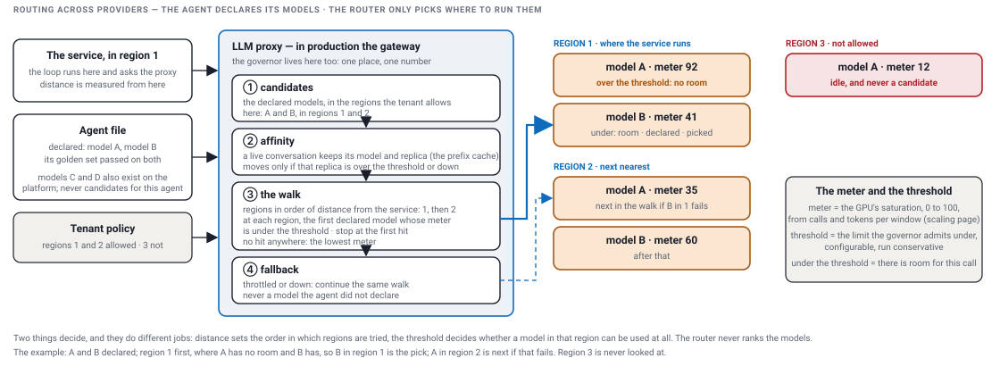

# Routing across providers

[The issue](#the-issue) · [The design](#the-design) · [The choices](#the-choices) · [What I ran](#what-i-ran-on-my-platform-in-production) · [What v2 implements](#what-v2-implements)

This page is design, from running a harness in production at scale. v2 has the seam and nothing behind it.

## The issue

- A platform has more than one model: a strong one and a cheap one, several providers, and each model in some regions and not others. A tenant's data may not leave its region. A provider throttles or goes down.
- The loop must not know any of this. It asks one entry point for a reply and gets one; where the reply came from is the entry point's problem.
- Two decisions hide in "which model": which models an agent may run on, and which one answers this call. The first is a quality decision; the second is a routing decision. Mixing them is how platforms end up guessing at runtime, for the agent.

## The design

The entry point is the LLM proxy from the HLD. In production it is the inference wrapper: the one multi-tenant service in front of the GPUs, which every tenant's calls go through, while the loop itself runs inside each tenant's own single-tenant service. The governor on the scaling page lives in that same wrapper, so routing and capacity are one decision made at one place, on one number.

The stance: the router never chooses a model for an agent. The agent declares the models its golden set passed on, say model A and model B out of the A, B, C, D the platform runs, and the router only picks where to run one of them. That leaves two runtime factors, where a model is and whether it has room, and they do different jobs: distance sets the order in which regions are tried, the threshold decides whether a model in that region can be used at all. The router never ranks the models.

Two words, so the walk below reads: the meter is the GPU's saturation, 0 to 100, computed per window from calls and tokens, the scaling page's number, kept per model per region. The threshold is the limit the governor admits under, configurable, run conservative. Under the threshold means there is room for this call.

1. **Candidates.** The declared models, in the regions the tenant allows: region law first, then the providers the contract permits, a bring-your-own key. In the picture: A and B, in regions 1 and 2; region 3 is never looked at. If the agent declares one model, the router only picks a region.
2. **Affinity.** A live conversation stays on the model and the replica that served it, because the prefix cache lives on the server that read the prompt. It moves only if that replica is over the threshold or down.
3. **The walk.** Regions in order of distance from where the service runs: region 1 first, then 2. At each region, the first declared model whose meter is under the threshold. Stop at the first hit. In the picture, A in region 1 has no room and B has, so B in region 1 is the pick. No hit anywhere: the lowest meter, so a call never waits on an empty answer.
4. **Fallback.** Throttled or down: continue the same walk, A in region 2 next. The chain is the walk itself, so a failover never leaves the declared models.

Every decision is explainable by reading: the declared set, the order of the regions, and the meter's number at that moment, which the governor already stores with each admission.

How an agent's declared set is made: by evals, never by the router.

- A new agent starts on one model; its golden set is recorded against it.
- The same golden set runs against a second model, usually a cheaper one. If tool choice holds and the answer score holds within the margin the owner set, that model is added to the agent's declared set; if not, it stays out. The eval page's table is the decision, and the router only ever sees names.
- After a change, the live judge watches that agent version's rate; a drop is the signal to take the model out of the set again.
- Finer than per agent, when a step can declare its own set: a cheaper model for the steps that classify, route or extract tool arguments, a stronger one for the step that reasons or writes the answer. Most of a turn's tokens are in the cheap steps.

## The choices

| Option | How it works | What you get | What it costs |
|---|---|---|---|
| a declared set per agent | the agent declares the models its golden set passed on; the router walks regions by distance and picks the first with room | explainable: every route is a lookup and a number, every change to the set has a table behind it | the set to keep per agent, and evals before a model joins it |
| a router model | a small classifier reads each request and sends the easy ones to the cheap model | cost down on mixed traffic | a call per request, and a hard question misrouted is a bad answer nobody can explain |
| a cascade | the cheap model first, a check on its answer, escalate on failure | the lowest average cost | the worst tail latency, and the check is a judge problem again |
| the provider's own router | the vendor routes within its catalog | nothing to build | one provider, and the quality rule is theirs, not the golden set's |

I pick the declared set per agent, with affinity, the walk by distance with the threshold as the gate, and the fallback inside the set. A router model only for a traffic class where the eval already showed the cheap model holds, never as the default.

## What I ran, on my platform in production

- One entry point in front of every model, with the three hosting choices behind it, dedicated, on demand and bring your own, and the tokens counted per tenant and model there.
- The nearest region with a backup in the next; the governor on the shared pool, on the scaling page.
- Routing within a declared set per agent is the design; the hosting choice, the nearest region with a backup, and the governor are what ran.

## What v2 implements

| Part | In v2 | Design only |
|---|---|---|
| the entry point | built: the LLM proxy, with the rule stub behind it | the gateway: the tenant filter, affinity, the walk by distance under the threshold, the fallback |
| the declared set | the golden set and the table that would decide it | running it against a second model and keeping the set per agent |
