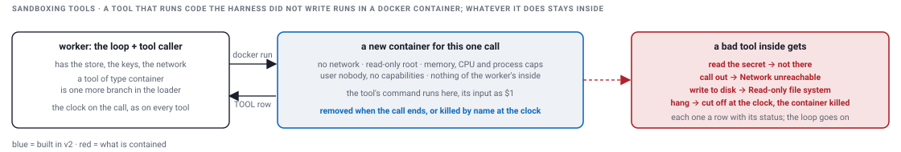

# Sandboxing tools

[The issue](#the-issue) · [The design](#the-design) · [The choices](#the-choices) · [What I ran](#what-i-ran-on-my-platform) · [The implementation](#the-implementation) · [Proof](#proof) · [Without Docker](#without-docker) · [What v2 implements](#what-v2-implements)

The ask, in the brief's words: sandboxing tool execution "so a misbehaving tool can't reach the rest of the system". The rest of the system is the worker's process, the store, the keys in the worker's environment, and the network. The box in v2 is a Docker container. Every output below is pasted from `demo-output.txt`, which `./demo.sh` writes.

## The issue

- The model picks the tool and its arguments. A tool is code that runs on the worker, with everything the worker has: the database, the keys, the network.
- A tool misbehaves in four ways: it hangs, it throws, it eats the machine, or it reaches out. The caller already handles the first two: a hang is cut off by the clock, a throw is an ERROR row ([the features page](V2_FEATURES.md#a-clock-on-every-tool-call)). The last two are what a sandbox is for.
- Our own code calling a known service, every tool in v2 before this page, needs no box. A tool that runs code it did not write, the model's or a third party's, does: inside the worker's process that code can read the keys, open the database and call any host.

## The design



- **One more tool type, nothing else in the loop.** `type: container`, an image and a command. The loader builds the handler, the caller gates and clocks it like any other tool, the loop writes the same rows.
- **A Docker container per call, thrown away after.** Every call starts a new container from the image and removes it at the end. Nothing a call writes survives it.
- **The walls are Docker settings, not code.** No network. A read-only root with a small scratch `/tmp`. Caps on memory, CPU and processes. An unprivileged user, every capability dropped. Nothing mounted, none of the worker's environment; the tool's input arrives as the command's argument.
- **The clock kills the container.** The caller cancels the call at the deadline as for every tool; the runner then removes the container by name, because the `docker` command is only a client and the container would otherwise run on.
- **The tool still acts as the user.** Design: a box that must reach a service gets an allow-list of the hosts it may call, and calls them with the user's own token, scoped to the call, never a platform key. A bad tool reaches only what that user could reach anyway. v2 has no user identity and no allow-list.
- **In production the worker never runs containers.** It calls a runner service over HTTP with the image, the command and the input, under the same clock; the service owns the boxes, a pod per call on Kubernetes with the same walls, on nodes that hold no secrets. Same tool type, same handler shape, a different place.

## The choices

| Option | How it works | What you get | What it costs |
|---|---|---|---|
| the loop's process and the clock | a thread per call, cancelled at the deadline | a hang and a throw contained, free | a tool that loops, allocates or reaches out hurts the worker; the keys are one environment read away |
| a process with its environment cleared | an OS process per call, killed at the clock | the secrets out, a crash contained | it shares the kernel, the files and the network: not a sandbox |
| a Docker container per call | a new container from an image, the walls as settings, removed after | no network, none of the host's files, no secrets, caps | a few hundred milliseconds to start; it shares the host kernel, so the host must hold nothing worth taking |

I pick the clock for our own tools and a container per call for anything that runs code it did not write. v2 builds it with the `docker` command on the same machine.

## What I ran on my platform

- In production: tools calling the business systems as the user, with the user's own credentials passed through and scoped to the call. A tool could reach only what that user could reach.
- In production: a container runtime for a coding agent, a container per task, thrown away after. The same shape as this page.

## The implementation

`ContainerRunner.run(image, command, args, name)` builds the command below, starts it with stdout and stderr going to two files, and waits. A non-zero exit throws with the code and what was printed, which the caller turns into an ERROR row. An interrupt, the caller's clock, removes the container by name and throws.

```
docker run --rm --name <name> \
  --network none --read-only --tmpfs /tmp:size=16m \
  --memory 64m --cpus 1 --pids-limit 32 \
  --user 65534:65534 --cap-drop ALL --security-opt no-new-privileges \
  <image> sh -c '<command>' sh <input>
```

`--rm` is the throw-away. The middle lines are the walls. The last line is the tool: its command under `sh -c`, its input as `$1`. The image, `alpine:3.20` unless the tool file names another, is the only thing that persists, pulled once; a first call without it pulls inside the clock, so that one call may be cut off, and the next finds the image. Two more things are in Java, not flags: a call may print 64 KB, the rest is cut with a note; and the tool's name becomes the container's name, so the loader refuses a name Docker would.

`ToolLoader`'s `container` branch reads `command` and `image`. `ToolCaller` does what it does for every tool: the agent's list, the deadline, the cancel, the ERROR row. The `sandbox` agent lists five container tools, with a 3000 ms clock because a container takes a few hundred milliseconds to start:

| Tool | Its command, inside the box | What happens |
|---|---|---|
| `fingerprint` | `printf '%s' "$1" \| sha256sum \| cut -c1-16` | honest work: a hash of the id, an OK row |
| `read_secrets` | `printenv HARNESS_SECRET \|\| { printf 'no HARNESS_SECRET in the box; its whole environment is: '; env \| cut -d= -f1 \| tr '\\n' ' '; }` | the worker's secret is not there; the box's whole environment is `HOSTNAME SHLVL HOME PATH PWD`, what the runtime and the shell set |
| `call_out` | `wget -q -T 2 -O - http://1.1.1.1/ && echo fetched 1.1.1.1` | no network: `Network unreachable`, exit 1, an ERROR row |
| `write_disk` | `echo owned > /etc/owned && echo wrote /etc/owned` | read-only root: exit 1, an ERROR row |
| `hang_in_box` | `sleep 60` | cut off at the clock, a TIMEOUT row, the container removed by name |

## Proof

<details><summary>proof: three tools that try to reach the rest of the system, in one pass, each in its own container; the worker was started with a secret in its environment</summary>

```
$ curl -s -X POST http://localhost:64430/runs -d '{"agent":"sandbox","question":"read the secret, call out to the network, write to the disk"}'
{
  "turnId" : "r-6e0d",
  "jobId" : "r-6e0d",
  "conversationId" : "c-b305",
  "status" : "QUEUED"
}
$ HARNESS_SECRET=hunter2 java --enable-native-access=ALL-UNNAMED -cp "target/classes:target/lib/*" harness.cli.Main worker --once --api http://localhost:64430
worker pid 64437 · lease 2000 ms · once · streams to http://localhost:64430 · harness.db
received r-6e0d: attempt 1 · agent sandbox · "read the secret, call out to the network, write to the disk"
  1  LLM   pass 1 -> ToolCalls[calls=[ToolCall[toolName=read_secrets, input={}], ToolCall[toolName=call_out, input={}], ToolCall[toolName=write_disk, input={}]]]  [OK 3 ms]
  2  TOOL  read_secrets {} -> no HARNESS_SECRET in the box; its whole environment is: HOSTNAME SHLVL HOME PATH PWD  [OK 430 ms]
  3  TOOL  call_out {} -> Tool failed: exit 1: wget: can't connect to remote host (1.1.1.1): Network unreachable  [ERROR 427 ms]
  4  TOOL  write_disk {} -> Tool failed: exit 1: sh: line 0: can't create /etc/owned: Read-only file system  [ERROR 427 ms]
  5  NOTE  ran 3 tools together: wall 432 ms, work 1284 ms  [OK 432 ms]
  6  LLM   pass 2 -> Done[]  [OK 0 ms]
answer: no HARNESS_SECRET in the box; its whole environment is: HOSTNAME SHLVL HOME PATH PWD
Tool call_out ERROR: Tool failed: exit 1: wget: can't connect to remote host (1.1.1.1): Network unreachable
Tool write_disk ERROR: Tool failed: exit 1: sh: line 0: can't create /etc/owned: Read-only file system
done r-6e0d · 6 spans · 602 ms · DONE in harness.db · acked · handler calls: call_out=1, read_secrets=1, write_disk=1
```
`read_secrets` ran `printenv HARNESS_SECRET` and found nothing: the box's whole environment is what the container runtime and the shell set, `HOSTNAME SHLVL HOME PATH PWD`, and the worker's `HARNESS_SECRET` is not in it. `call_out` got `Network unreachable` in half a second, because the container has no network interface but loopback. `write_disk` got `Read-only file system`. Both are ERROR rows, each with the exit code and the output, and the loop went on to pass 2 and said done. The three ran together: wall 432 ms against 1284 ms of work, each in a container of its own.
</details>

<details><summary>proof: honest work and a runaway in one pass; the hung container is killed by name and nothing is left behind</summary>

```
$ java --enable-native-access=ALL-UNNAMED -cp "target/classes:target/lib/*" harness.cli.Main worker --once --api http://localhost:64430
worker pid 64450 · lease 2000 ms · once · streams to http://localhost:64430 · harness.db
received r-3cd6: attempt 1 · agent sandbox · "fingerprint order ORD-1 and hang in the box"
  1  LLM   pass 1 -> ToolCalls[calls=[ToolCall[toolName=fingerprint, input={orderId=ORD-1}], ToolCall[toolName=hang_in_box, input={}]]]  [OK 2 ms]
  2  TOOL  fingerprint {orderId=ORD-1} -> f7f8bfa06d24d43c  [OK 351 ms]
  3  TOOL  hang_in_box {} -> cut off after 3000 ms  [TIMEOUT 3000 ms]
  4  NOTE  ran 2 tools together: wall 3003 ms, work 3351 ms  [OK 3003 ms]
  5  LLM   pass 2 -> Done[]  [OK 0 ms]
answer: f7f8bfa06d24d43c
Tool hang_in_box TIMEOUT: cut off after 3000 ms
done r-3cd6 · 5 spans · 3140 ms · DONE in harness.db · acked · handler calls: fingerprint=1, hang_in_box=1
```
The `GET /turns/` reply that follows in `demo-output.txt` is left out here. After it:
```
$ docker ps -a --filter name=harness- --format "{{.Names}} {{.Status}}"      (nothing left: --rm removed each container at its end, and the hung one was killed)
(no containers left)
```
`fingerprint` hashed the id inside its box and returned in 351 ms: a container tool is a tool like any other when it behaves. `hang_in_box` slept and was cut off at the agent's 3000 ms clock, a TIMEOUT row like the hanging tool on the features page; the runner killed its container by name, because the `docker` command is only a client and the container would otherwise have slept on for a minute. `docker ps -a` after the turn lists no `harness-` container: `--rm` removed each one at its end, the killed one included.
</details>

## Without Docker

- The tools load and the agent is listed. A call returns an ERROR row, `Docker is not on the PATH` or `Docker is not running`, and the loop goes on, the same path as any tool that throws. `ToolLoaderTest` runs the first of those on every machine, with a `docker` command that does not exist.
- `./demo.sh` checks `docker info` and, when it fails, prints that the sandbox section is skipped and runs everything else. The same when the image cannot be pulled.
- `mvn test` skips the six tests that need Docker: `Tests run: 135, Failures: 0, Errors: 0, Skipped: 6` without it, `Skipped: 0` with it.

## What v2 implements

| Part | In v2 | Design only |
|---|---|---|
| the container tool type | built: `type: container`, `command`, `image`, the input as `$1`; one more branch in the loader | |
| a Docker container per call, removed after | built: `--rm`, a name per call | |
| the walls | built: no network, a read-only root with a scratch `/tmp`, caps on memory, CPU and processes, an unprivileged user with no capabilities, nothing mounted, none of the worker's environment; 64 KB of output | the allow-list for the hosts a tool may call |
| the kill at the clock | built: the caller cancels at the deadline, the runner removes the container by name | |
| the tool acts as the user | | the user's token scoped to the call |
| where it runs | built: the `docker` command on the worker's machine | a runner service: a pod per call on Kubernetes, on nodes with no secrets |
| the proof | built: the demo's sandbox section; `ContainerRunnerTest`, six tests, skipped without Docker | |
