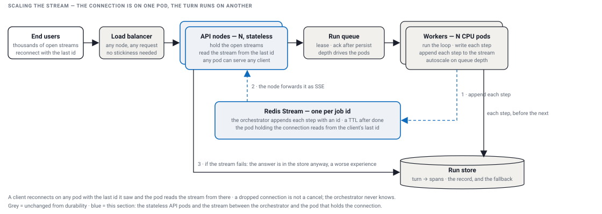
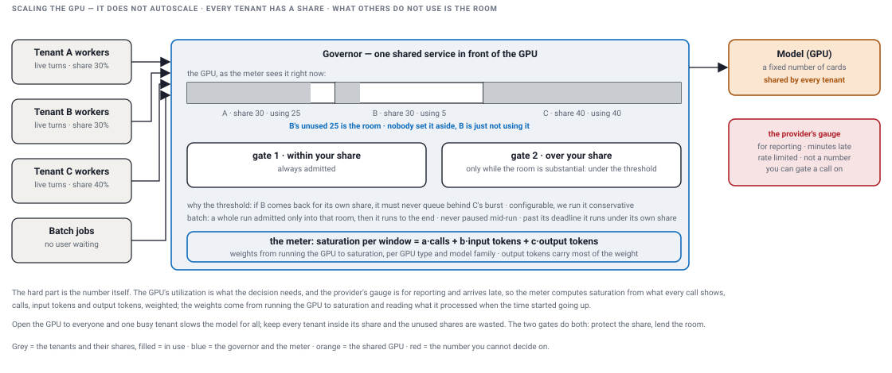

# Scaling and performance

[Scaling the orchestrator pods, CPU](#scaling-the-orchestrator-pods-cpu) · [Scaling the persistent connection](#scaling-the-persistent-connection) · [Scaling the GPU, the one thing that does not autoscale](#scaling-the-gpu-the-one-thing-that-does-not-autoscale) · [Scaling the tools and the state](#scaling-the-tools-and-the-state) · [Performance](#performance-what-the-model-sees-on-every-call) · [Out of scope](#out-of-scope)

The loop itself is cheap. What has to scale is around it: the pods that run the loop, the connections that carry the answer back, the one GPU every tenant shares, and the context the model reads on every call. Durability already moved the loop behind a queue; this page builds on that picture.

## Scaling the orchestrator pods, CPU

- Standard: Kubernetes autoscales the API pods on load, and the orchestrator pods on load and on the queue depth. Provision for spikes, keep a few pods warm. Nothing new here.
- The consequence that matters: the queue already cut the direct line between the user's connection and the loop that runs their turn; the pod that holds the connection and the pod that runs the turn are different pods, with nothing joining them. That is the next problem.

## Scaling the persistent connection

The user's connection is open on one API pod. Their turn is running on an orchestrator pod, and there is no direct line between the two: the queue sits in the middle, so the orchestrator never knows which pod holds the connection, and if the connection drops and comes back it is on another pod. The orchestrator has to reach whichever pod holds the connection, every time.

- **A Redis Stream per job id.** The orchestrator appends each step to it as the step happens. The API pod holding the connection reads the stream from the last id the client saw and forwards each entry as a Server-Sent Event.
- **Reconnect on any pod.** The client sends the last id it saw; the new pod reads from there. Nothing lost, nothing twice. A TTL clears the stream after the turn is done.
- **Why a Stream and not pub/sub.** Pub/sub has no buffer: a client away for a second misses what was published. A Stream keeps the entries with ids, so the gap is replayed from Redis. Other queues do this too, but they are heavier, and we already run a Redis cluster.
- **The stream is for the live experience.** The orchestrator writes every step and the final answer to the store anyway, so if the stream fails the API or the client gets the answer from the store. That works, and it is a bad experience; the stream is what makes it a good one.
- **A dropped connection is not a cancel.** The turn keeps running; cancel is its own request.

| Option | How it works | What you get | What it costs |
|---|---|---|---|
| Redis pub/sub by job id | the orchestrator publishes, the holding pod forwards | the smallest piece that frees the turn from the pod | no buffer: anything published while the client was away is gone |
| Redis Stream per job id | the orchestrator appends with ids; the holding pod reads from the client's last id; a TTL after done | the buffer: replay from the last id; de-duplication by id for free | a stream per job in Redis until its TTL; ids on the client |
| poll the store | the client reads rows past its last id on a timer | no new infrastructure | latency is the poll interval; a store read per poll per connection |

I pick the Redis Stream: we already run the cluster, and the buffer is the whole point. The same shape is in HelloInterview's Design ChatGPT write-up: a run id, a stream per run, any node replays from the last id.

**What I ran.** The first shape streamed the turn on the same request that started it, one pod running the whole loop inside that request's timeout; a mid-turn drop lost the in-flight events and kept what was persisted at the end. My own note for the next shape is the thin API layer subscribing by run id; the Stream with replay from the last id is the designed fix, not shipped.

## Scaling the GPU, the one thing that does not autoscale

The GPU does not autoscale. It is a fixed number of cards shared by every tenant, so the job is to use all of it and never let it fall over.

- **The opener.** Open the GPU to everyone and one busy tenant slows the model for all of them; a slow model is a slow platform. Close it and you pay for an idle GPU while customers wait for their batch. "Let it in and it slowed everyone's live chat. Keep it out and the GPU sat idle while customers waited."
- **The catch.** The decision needs the GPU's utilization, and the cloud provider's number is a reporting metric: minutes late, behind a rate-limited metrics API. You call it for reporting, not for a decision made per call. "Delayed is useless for the gate, perfect for the calibration."
- **So the meter computes saturation itself,** per window, from what every call shows: calls, input tokens, output tokens, weighted. The weights come from running the GPU to saturation and reading what it processed when the time started going up, keyed by GPU type and model family. Output tokens carry most of the weight: generating is the cooking, reading the input is cheap.
- **Gate one, the fair share.** Every tenant gets a share of the GPU; within the share a live call is always admitted.
- **Gate two, the room.** If a tenant is not using its share, that capacity is not set aside anywhere, it is simply wasted. So over the share a call is admitted too, but only while the room is substantial, under the threshold. The threshold is the margin: a tenant coming back for its own share must never queue behind someone else's burst. Batch is admitted the same way, a whole run at a time, only into that room; once admitted it runs to the end, the wait between calls is the brake, a run is never paused mid-flight.
- **The threshold is configurable per cluster, and we run it conservative,** because the cost of a run is an estimate and the meter is a window behind.
- **The guarantee for batch:** wait for headroom up to your deadline, then run through the live channel under your tenant's share. Worst case is what you had before. Rising deadline breaches are the signal to buy more GPU, with the evidence in hand.

| Option | How it works | What you get | What it costs |
|---|---|---|---|
| the provider's utilization gauge | each pod polls it and gates on it | nothing to build | minutes late, rate limited; a reporting number, not one you can gate a call on |
| a rate limit that counts calls | calls per tenant per window in each pod | simple, needed anyway | counts calls, not work: too loose and one output-heavy tenant tips the GPU, too tight and live is throttled on an idle GPU; no door for batch at all |
| a dedicated GPU for batch | a second cluster for batch jobs | isolation by construction | idle whenever there is no batch: the same waste, mirrored |
| run batch at night | a fixed off-peak window | no admission logic | midnight here is daytime elsewhere; there is no night |
| pause a running job when the GPU tips | preempt batch on a spike | the fastest brake | mid-flight state; too invasive, and my own first idea; the run became the unit, admitted whole, never cancelled |
| own meter, one shared service in front of the GPU | the formula above, fair share for live, batch into headroom under a conservative threshold | a fresh number nobody had; batch in the valleys, day or night; live protected; no new GPUs | the first shared service in a single-tenant estate; calibration per GPU type and model; the threshold has to stay conservative |

I pick the meter and the shared service, because a pod only ever sees its own slice and only something in front of the whole GPU can have the number.

**What I ran.** Nobody asked for a capacity system; I drove it, the platform's first shared service. The first rate limit counted calls, not work, and getting the number right took incidents: too loose one day, too tight the next. We wanted the provider's utilization and could not use it, so we calculated it ourselves and ran the GPU to saturation to get the formula; when the provider swapped the GPU type under a cluster the numbers fell apart, and the GPU type became part of the calibration. Live got a fair share per tenant on that number. Batch got a queue, admitted into headroom under a threshold we run conservative, a run at a time, never cancelled; I wanted to pause runs mid-flight, the team said too invasive, and they were right. The second gate for live, over the share into the room, is designed on the same number and not built. My part: the direction, the business case, and the admission side, the queue, the worker, the advisor and the runbooks.

## Scaling the tools and the state

- **Tools.** One question is several tool calls and an authorization check for each of them, so the downstreams see ten to fifty times the traffic the same work makes through the UI. They were sized for a human clicking, not an agent looping. Every tool call gets a timeout, and the next fixes are a pooled client, a per-tool limit and a circuit breaker on the hottest path.
- **State.** The step row is the ledger; telemetry is written behind it, never one fat synchronous write per step. The scar: with no telemetry store, the relational state store quietly absorbed the observability writes too, tens of rows and a hundred kilobytes per conversation, and write latency became conversation latency. The right answer is a stream into a column store, separated from the state store on day one.
- **Tenancy.** The tenant id rides on the turn and on every call. Where the tenant owns the infrastructure, isolation is routing. At the one shared step, the GPU, isolation is admission: that is the governor above.

## Performance: what the model sees on every call

Performance is time and tokens, and it has its own page: [PERFORMANCE.md](PERFORMANCE.md). Four optimizations, each with its picture: the prefix cache and prompt order, tools in the hundreds, dedupe of tool results, and multi-agent leakage; and for each, what v2 implements.

## Out of scope

Not built in this repo, said once: Redis and the multi-node stream, the inference gateway and the governor, the context budget and the summary fold, the tool catalog and its index. Each is a design above with the seam it plugs into named: the API layer, the model interface, the context builder, the tool registry.
