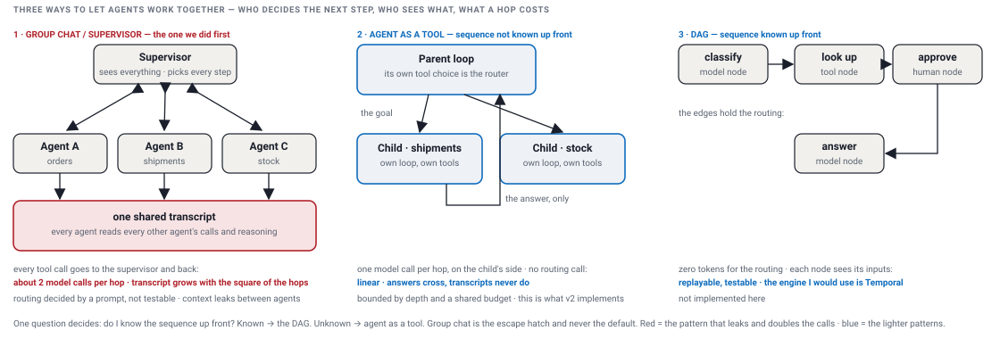

# Sub-agents: an agent as a tool

[The issue](#the-issue) · [The choices](#the-choices) · [Agent as a tool](#agent-as-a-tool) · [The implementation](#the-implementation) · [Proof](#proof) · [The DAG](#the-dag)

A run can hand a question to another agent and get the answer back as a tool result: the child is the same loop class, run inside the tool call, its rows in the same turn (job id). There are more multi-agent patterns in the frameworks than the three on this page; these are the ones I have run in production at scale, and they cover most of what teams need. Every output below is pasted from `demo-output.txt`, which `./demo.sh` writes.

## The issue

- Several specialists need several agents: the concierge knows orders, the logistics agent knows shipments, one question can need both.
- Every hand-off costs model calls and context, and a hop nobody measured is a cost nobody sees.
- The question every multi-agent shape has to answer: who decides the next step, and who sees what.

## The choices

Three ways to let agents work together. The first is the one we did, and it was the wrong default; the other two are the ones that work, and they answer different questions.



| option | who decides the next step | who sees what | cost per hop |
|---|---|---|---|
| group chat / supervisor broadcast | a supervisor model, every round, from the whole transcript | every agent sees the whole monologue | about two model calls per hop, the worker's and the supervisor's, and the transcript grows with every hop, so the tokens grow with the square of the hops |
| agent as a tool | the parent's own tool choice: the call that happens anyway is the routing | the child sees the goal and its tools; the parent sees the answer | one model call per hop on the child's side, no routing call; linear in the hops |
| DAG (directed acyclic graph: the flow drawn as nodes and edges) | nobody at run time: the edges hold the sequence | each node sees its inputs | zero tokens for the routing; replayable, testable |

One question decides: do I know the sequence up front? Known → the DAG. Unknown → agent as a tool. Group chat is risky and never the default.

Things to watch for:

- one agent's context leaking into another's: the answer should cross, not the transcript;
- the same leak inside a DAG: the router node, a model or a plain rule, and the nodes after it share one conversation; a node's tool calls and a child agent's context must stay inside the node, only its output passes on, or the DAG is a broadcast again. Watch this one closely; it is common;
- a supervisor that must see everything to decide anything;
- cost per hop that nobody measured;
- an agent that delegates to itself (the depth cap);
- a tree that burns passes (the shared budget).

We picked a framework's group chat as our first multi-agent default, and I had not researched the pattern enough. One release in, with teams building on it, the numbers came back: up to twice the model calls, and every agent reading the whole conversation. I went to leadership and stopped new teams on it. The paths we knew moved onto our DAG, the rest onto agent as a tool. Median latency on the migrated paths dropped by about a third. The cost was one missed release for the teams on it, caught before production.

## Agent as a tool

When the sequence is not known up front, the parent's own tool choice is the router. The child loop is the same Orchestrator class, run inside a tool call; the HLD picture does not change.

The example: `concierge` (tools `order_status`, `ask_logistics`) is asked "Where is shipment SHP-1 for my order?"; `logistics` (tools `shipping_status`) is the agent behind `ask_logistics`.

| span | depth | kind | what happened |
|---|---|---|---|
| 1 | 0 | LLM | the concierge decides `ask_logistics`, goal = the question; written before the child runs |
| 2 | 1 | LLM | the logistics agent decides `shipping_status` (parent 1) |
| 3 | 1 | TOOL | `shipping_status` → "Shipment SHP-1: IN TRANSIT, arriving 2026-10-16" (parent 1) |
| 4 | 1 | LLM | the logistics agent says Done (parent 1) |
| 5 | 0 | AGENT | `ask_logistics` → the child's answer: the one row that crosses back |
| 6 | 0 | LLM | the concierge says Done; the turn's answer is the child's answer |

The child sees only what the parent hands it: the goal, and its own tools. The parent sees only what comes back: the answer, as a tool result. Nothing else crosses, in either direction: not the child's prompt, reasoning or tool outputs, not the parent's question or history.

- **API layer**: nothing new; a `concierge` turn is one id and one stream like any other.
- **Orchestrator**: the parent loop; an `agent` tool's call runs a child Orchestrator, the same class, with depth + 1 and the turn's budget passed into its constructor.
- **Tool layer**: a fourth tool type, `agent`: the file names the agent, the loop that offers the tool binds it to itself.
- **Child loop**: the logistics agent's own loop, tools and timeout; it returns an answer, never its transcript; fresh per call.
- **Model**: the same stub for both; it hands the child the whole question as its goal.
- **Run store**: no new row, no new table; the child's spans carry `parent` and `depth` in `attrs`, so the API, the stream and `replay` show the tree.
- **Bounds in the loop, not in the prompt**: depth cap 2, so an agent that lists itself ends with an `ERROR` row, `depth limit`, never a stack overflow; one budget of model calls per turn (`maxModelCalls`, default 20) shared down the tree, and spent means `FAILED` with a NOTE row, `budget exhausted`.
- Out of scope for the POC: a worker that dies inside a child loop (resume reads the saved rows as one flat list); two agent tools in one pass, which interleave their rows.

## The implementation

An agent tool is a file; the loop that offers it binds the handler to itself; the handler runs a child loop and hands the answer back. On another host the same call goes over the network to that agent; nothing else changes.

<details><summary>the tool file: type agent</summary>

```json
{ "name": "ask_logistics", "description": "Shipment questions go to the logistics agent", "type": "agent",
  "agent": "logistics", "inputField": "goal", "match": { "keywords": ["shipment", "shipping", "tracking"], "idPattern": "SHP-\\d+" } }
```
`agent` names the file in `agents/`; `match` picks the tool like any other; `inputField` is the goal the child gets.
</details>

<details><summary>the adapter: a child Orchestrator inside the tool call</summary>

```java
// in the constructor: the loop that offers an agent tool binds it to itself, and the caller runs the bound copy
tools.add(tool.isAgent() ? tool.bound(input -> delegate(tool.agent(), input.getOrDefault(tool.inputField(), ""))) : tool);
toolCaller.bind(tools);

// the adapter: the same class, one level deeper, this loop's last span and the turn's budget passed in
private String delegate(Agent child, String goal) {
    if (depth >= MAX_DEPTH) {
        throw new IllegalStateException("depth limit: a loop at depth " + depth + " cannot delegate");
    }
    Turn turn = conversation.turns().getLast();
    ToolCaller childCaller = new ToolCaller(registry, child.toolNames(), Duration.ofMillis(child.toolTimeoutMs()));
    Orchestrator childLoop = new Orchestrator(child, registry, llm, childCaller, summarizer, store, listener,
            depth + 1, lastSpan, budget);
    return childLoop.asChild(conversation.id(), turn.id(), goal);
}

// the child's side: the goal is its question, in a turn that shares the parent's id; no row of its own, no status change
String asChild(String conversationId, String turnId, String goal) {
    conversation = new Conversation(conversationId, agent);
    Turn turn = conversation.turn(turnId, goal);
    return loop(turn, 1);
}
```
The child is built from the parent's pieces, with its own agent, tool caller and depth; a throw inside it is a tool error to the parent, which is how the depth limit surfaces as a row.
</details>

What changed: a tool type, `agent`, in the loader; a row kind, `AGENT`; a `TurnBudget` per turn for span numbers and model calls, passed with depth and parent span into the loop's constructor, which binds its agent tools to itself; `record` numbers from the budget and stamps the two keys on a child's rows, `loop` asks the budget before each model call; the caller runs the bound copy; indentation in the printers.

What did not change: the loop's steps (ask, write, run, write, repeat), the resume path, the store, the schema, the queue, the endpoints, the stream.

## Proof

The demo over HTTP: the concierge turn, then the loop agent stopped by the depth cap.

<details><summary>proof: the concierge turn, the nested spans, the one answer</summary>

```
$ curl -s -X POST http://localhost:62588/runs -d '{"agent":"concierge","question":"Where is shipment SHP-1 for my order?"}'
{
  "turnId" : "r-e0ee",
  "jobId" : "r-e0ee",
  "conversationId" : "c-9a7f",
  "status" : "QUEUED"
}
(the worker prints the child's rows indented: the parent's decision, the child's three rows, the AGENT row with the child's answer, the parent's done)
$ java --enable-native-access=ALL-UNNAMED -cp "target/classes:target/lib/*" harness.cli.Main worker --once --api http://localhost:62588
worker pid 48806 · lease 2000 ms · once · streams to http://localhost:62588 · harness.db
received r-e0ee: attempt 1 · agent concierge · "Where is shipment SHP-1 for my order?"
  1  LLM   pass 1 -> ToolCall[toolName=ask_logistics, input={goal=Where is shipment SHP-1 for my order?}]  [OK 2 ms]
    2  LLM   pass 1 -> ToolCall[toolName=shipping_status, input={shipmentId=SHP-1}]  [OK 0 ms]
    3  TOOL  shipping_status {shipmentId=SHP-1} -> Shipment SHP-1: IN TRANSIT, arriving 2026-10-16  [OK 0 ms]
    4  LLM   pass 2 -> Done[]  [OK 0 ms]
  5  AGENT  ask_logistics {goal=Where is shipment SHP-1 for my order?} -> Shipment SHP-1: IN TRANSIT, arriving 2026-10-16  [OK 10 ms]
  6  LLM   pass 2 -> Done[]  [OK 0 ms]
answer: Shipment SHP-1: IN TRANSIT, arriving 2026-10-16
done r-e0ee · 6 spans · 123 ms · DONE in harness.db · acked · handler calls: shipping_status=1
(the same rows over HTTP: the child's spans carry parent and depth in attrs, the AGENT span carries the child's answer, and the turn's answer is that answer)
$ curl -s http://localhost:62588/turns/r-e0ee
{
  "id" : "r-e0ee",
  "conversationId" : "c-9a7f",
  "agent" : "concierge",
  "question" : "Where is shipment SHP-1 for my order?",
  "answer" : "Shipment SHP-1: IN TRANSIT, arriving 2026-10-16",
  "status" : "DONE",
  "claimedBy" : "48806",
  "attempts" : 1,
  "createdAt" : 1792045732185,
  "updatedAt" : 1792045732869,
  "spans" : [ {
    "turnId" : "r-e0ee",
    "span" : 1,
    "pass" : 1,
    "kind" : "LLM",
    "request" : "pass 1",
    "response" : "ToolCall[toolName=ask_logistics, input={goal=Where is shipment SHP-1 for my order?}]",
    "status" : "OK",
    "ms" : 2,
    "attrs" : {
      "question" : "Where is shipment SHP-1 for my order?",
      "tool" : "ask_logistics",
      "goal" : "Where is shipment SHP-1 for my order?"
    }
  }, {
    "turnId" : "r-e0ee",
    "span" : 2,
    "pass" : 1,
    "kind" : "LLM",
    "request" : "pass 1",
    "response" : "ToolCall[toolName=shipping_status, input={shipmentId=SHP-1}]",
    "status" : "OK",
    "ms" : 0,
    "attrs" : {
      "question" : "Where is shipment SHP-1 for my order?",
      "tool" : "shipping_status",
      "shipmentId" : "SHP-1",
      "parent" : "1",
      "depth" : "1"
    }
  }, {
    "turnId" : "r-e0ee",
    "span" : 3,
    "pass" : 1,
    "kind" : "TOOL",
    "request" : "shipping_status {shipmentId=SHP-1}",
    "response" : "Shipment SHP-1: IN TRANSIT, arriving 2026-10-16",
    "status" : "OK",
    "ms" : 0,
    "attrs" : {
      "tool" : "shipping_status",
      "shipmentId" : "SHP-1",
      "key" : "r-e0ee/2",
      "parent" : "1",
      "depth" : "1"
    }
  }, {
    "turnId" : "r-e0ee",
    "span" : 4,
    "pass" : 2,
    "kind" : "LLM",
    "request" : "pass 2",
    "response" : "Done[]",
    "status" : "OK",
    "ms" : 0,
    "attrs" : {
      "question" : "Where is shipment SHP-1 for my order?",
      "parent" : "1",
      "depth" : "1"
    }
  }, {
    "turnId" : "r-e0ee",
    "span" : 5,
    "pass" : 1,
    "kind" : "AGENT",
    "request" : "ask_logistics {goal=Where is shipment SHP-1 for my order?}",
    "response" : "Shipment SHP-1: IN TRANSIT, arriving 2026-10-16",
    "status" : "OK",
    "ms" : 10,
    "attrs" : {
      "tool" : "ask_logistics",
      "goal" : "Where is shipment SHP-1 for my order?",
      "key" : "r-e0ee/1"
    }
  }, {
    "turnId" : "r-e0ee",
    "span" : 6,
    "pass" : 2,
    "kind" : "LLM",
    "request" : "pass 2",
    "response" : "Done[]",
    "status" : "OK",
    "ms" : 0,
    "attrs" : {
      "question" : "Where is shipment SHP-1 for my order?"
    }
  } ]
}
```
</details>

<details><summary>proof: the depth cap, an agent that lists itself as a tool</summary>

```
$ curl -s -X POST http://localhost:62588/runs -d '{"agent":"loop","question":"loop, please"}'
{
  "turnId" : "r-1e43",
  "jobId" : "r-1e43",
  "conversationId" : "c-6e13",
  "status" : "QUEUED"
}
(loop delegates to loop delegates to loop; the loop at depth 2 may not delegate again, so its call is refused with an ERROR row, depth limit, and the answer climbs back up)
$ java --enable-native-access=ALL-UNNAMED -cp "target/classes:target/lib/*" harness.cli.Main worker --once --api http://localhost:62588
worker pid 48814 · lease 2000 ms · once · streams to http://localhost:62588 · harness.db
received r-1e43: attempt 1 · agent loop · "loop, please"
  1  LLM   pass 1 -> ToolCall[toolName=ask_loop, input={goal=loop, please}]  [OK 2 ms]
    2  LLM   pass 1 -> ToolCall[toolName=ask_loop, input={goal=loop, please}]  [OK 0 ms]
      3  LLM   pass 1 -> ToolCall[toolName=ask_loop, input={goal=loop, please}]  [OK 0 ms]
      4  AGENT  ask_loop {goal=loop, please} -> Tool failed: depth limit: a loop at depth 2 cannot delegate  [ERROR 0 ms]
      5  LLM   pass 2 -> Done[]  [OK 0 ms]
    6  AGENT  ask_loop {goal=loop, please} -> Tool ask_loop ERROR: Tool failed: depth limit: a loop at depth 2 cannot delegate  [OK 12 ms]
    7  LLM   pass 2 -> Done[]  [OK 0 ms]
  8  AGENT  ask_loop {goal=loop, please} -> Tool ask_loop ERROR: Tool failed: depth limit: a loop at depth 2 cannot delegate  [OK 21 ms]
  9  LLM   pass 2 -> Done[]  [OK 0 ms]
answer: Tool ask_loop ERROR: Tool failed: depth limit: a loop at depth 2 cannot delegate
done r-1e43 · 9 spans · 173 ms · DONE in harness.db · acked · handler calls: none
```
</details>

- Six rows, one numbering, one turn: 1 the parent's decision, 2 to 4 the child's with `parent 1` and `depth 1`, 5 the `AGENT` row with the child's answer, 6 the parent's done; the turn's `answer` is the child's.
- Span 2's `attrs` hold the child's question, the goal, and nothing of the parent's conversation; span 5 is the only row of the child's work the parent's loop saw.
- The loop agent goes three loops deep and stops: row 4, at depth 2, is the refused call, `depth limit`, an `ERROR`; each loop above relays it and says done; six model calls, no stack overflow.

## The DAG

The other pattern, for when the sequence is known. Most of the time you do know your workflow, and workflows can be long, so scaling them is the concern. The DAG holds the flow and the model never decides it: the routing is the edges, zero tokens, replayable, testable. Where a model node does route, at the top, it routes on its inputs only: the nodes share one conversation, so each node's tool calls and child context stay inside the node and only its output goes on, or the leak from pattern 1 is back.

For this proof of concept I built agent as a tool, because the example's sequence is not known up front and it fits the loop we already have. The DAG is just as implementable, and it is better implemented on a workflow engine such as Temporal than hand-rolled: durable, replayable, a long workflow survives its worker. Which of the two a platform leans on is a choice to validate and weigh against its own workloads, not a ranking; my platform ended up with both.
