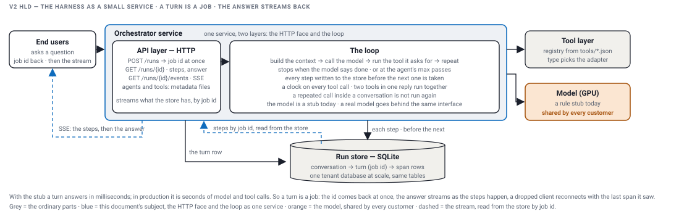

# v2 HLD: keeping it simple

[What v2 is](#what-v2-is) · [The data model](#the-data-model) · [The HTTP endpoints](#the-http-endpoints) · [Streaming the answer](#streaming-the-answer) · [Persistence](#persistence) · [Agents and tools are metadata](#agents-and-tools-are-metadata) · [Try it](#try-it) · next: [v2: additional features](V2_FEATURES.md)

The harness as a small service: you call it over HTTP, its state lives in one SQLite file, and the answer streams back as the steps happen. The model is still a stub; nothing needs a key or a network. Every output below is from a real run of `./demo.sh`; the committed `demo-output.txt` is a later run, so its ids and timings differ, nothing else.

## What v2 is



- **End users** ask a question and get a job id back at once; the answer follows as a stream.
- **API layer** is the one face: `POST /runs` writes the turn row and returns its id; `GET /turns/{id}` reads it; `GET /turns/{id}/events` streams it.
- **Orchestrator** is the loop: build the context, call the model, run the tool it asks for, repeat until the model says done or the agent's pass cap hits. Every step is written to the store before the next one is taken. What else the loop already does, parallel tool calls, the clock on every call, the tool-list gate, the caps, the answer, is on the next page, [v2: additional features](V2_FEATURES.md), each with a run.
- **One service, two layers.** The HTTP face and the loop are drawn as one service here. Splitting them, so a turn outlives the request that created it, is the durability page, and v2's `serve` and `worker` commands are that split; the Try it section runs both.
- **Tool layer** is the registry built from `tools/*.json`; the file's type picks the adapter, the agent's file says which tools it may call and for how long.
- **Model** is a rule stub today; a real model goes behind the same interface, and in production it is the one step shared by every customer.
- **Run store** is SQLite here and the tenant database at scale, same tables.
- **The dashed arrow** is the run's stream: the loop pushes each step and each piece of the answer as it happens, the API holding the connection forwards it to the client. The store is read only if the stream is gone.

Why a job id and a stream, when the stub answers in milliseconds:

- In production a turn is several seconds of model and tool calls, and longer once tools call real systems.
- So a turn is a job: the id comes back at once, the answer streams as the steps land, a client that drops reconnects with the last step it saw.
- Durability needs the same id, so we design for it now.

## The data model

Three tables, from the whiteboard: a conversation has turns, a turn is one job, a turn has spans.

| Table | Columns |
|---|---|
| `conversation` | `id` · `agent` · `created_at` |
| `turn` | `id` (the job id) · `conversation_id` · `question` · `answer` · `status` (QUEUED · RUNNING · DONE · FAILED) · `claimed_by` · `attempts` · `created_at` · `updated_at` |
| `span` | `turn_id` · `span` (the step number) · `pass` · `kind` (LLM · TOOL · AGENT · NOTE) · `request` · `response` · `status` · `ms` · `attrs` (JSON) · key (`turn_id`, `span`) |

The durability section adds a fourth, `queue` (`turn_id` · `visible_at` · `receives`). Span numbers run on through a conversation, so a later turn points at an earlier turn's span by one number.

<details><summary>the SQL that creates the tables</summary>

```sql
CREATE TABLE IF NOT EXISTS conversation (
  id TEXT PRIMARY KEY, agent TEXT, created_at INTEGER);
CREATE TABLE IF NOT EXISTS turn (
  id TEXT PRIMARY KEY, conversation_id TEXT, question TEXT, answer TEXT, status TEXT,
  claimed_by TEXT, attempts INTEGER DEFAULT 0, created_at INTEGER, updated_at INTEGER);
CREATE TABLE IF NOT EXISTS span (
  turn_id TEXT, span INTEGER, pass INTEGER, kind TEXT, request TEXT, response TEXT,
  status TEXT, ms INTEGER, attrs TEXT, PRIMARY KEY (turn_id, span));
```
</details>

## The HTTP endpoints

| Method | Path | What it does | Returns |
|---|---|---|---|
| GET | `/agents` | the agents, from `agents/*.json` | `200`, a list |
| GET | `/agents/{name}` | one agent file | `200`; `404` |
| GET | `/tools` | the tools, from `tools/*.json` | `200`, a list |
| POST | `/runs` | body `{"agent","question"}`: writes the turn row and queues it; `{"conversationId","question"}` adds a turn to that conversation | `202 {"turnId","jobId","conversationId","status":"QUEUED"}` at once |
| GET | `/turns/{id}` (also `/runs/{id}`) | the turn, its spans, the answer when done | `200`; `404` |
| GET | `/turns/{id}/events` | the run's stream from `Last-Event-ID`: `step` and `token` events as they happen, then `done` with the answer; the saved rows only if the stream is gone | `200 text/event-stream` |
| POST | `/turns/{id}/events` | the worker's push: body `{"event","data"}`, appended to the run's stream; the stand-in for the Redis Stream append | `204`; `404` |
| POST | `/evals` | the golden set, scored in the server | `200`, the table as `cases` and `lines` |

The server is the JDK's own HTTP server, one virtual thread per request, JSON by hand. No framework. In the code the loop is already in its own process, `worker`, over the same file; why is the durability page.

<details><summary>the handler for POST /runs</summary>

```java
String agentName = text(body, "agent");
agent = findAgent(agentName).orElseThrow(() -> new HttpError(400, "no agent named " + agentName));
conversationId = store.newConversation(agent.name());
String turnId = queue.submit(conversationId, question);
return send(exchange, 202, JSON.createObjectNode().put("turnId", turnId).put("jobId", turnId)
        .put("conversationId", conversationId).put("status", TurnRow.Status.QUEUED.name()));
```
The turn row and its queue message go in first, in one transaction, the `202` goes out, and a worker runs the loop.
</details>

<details><summary>proof: POST a question, then GET the turn</summary>

```
$ curl -s -X POST http://localhost:58833/runs -d '{"agent":"support","question":"What is the status of order ORD-1?"}'
{
  "turnId" : "r-478b",
  "jobId" : "r-478b",
  "conversationId" : "c-2674",
  "status" : "QUEUED"
}
$ curl -s http://localhost:58833/turns/r-478b
{
  "id" : "r-478b",
  "conversationId" : "c-2674",
  "agent" : "support",
  "question" : "What is the status of order ORD-1?",
  "answer" : "Order ORD-1: SHIPPED, shipment SHP-1",
  "status" : "DONE",
  "claimedBy" : "31582",
  "attempts" : 1,
  "spans" : [
    { "span" : 1, "pass" : 1, "kind" : "LLM",  "response" : "ToolCall[toolName=order_status, input={orderId=ORD-1}]", "status" : "OK", "ms" : 4 },
    { "span" : 2, "pass" : 1, "kind" : "TOOL", "response" : "Order ORD-1: SHIPPED, shipment SHP-1", "status" : "OK", "ms" : 0, "attrs" : { "key" : "r-478b/1" } },
    { "span" : 3, "pass" : 2, "kind" : "LLM",  "response" : "Done[]", "status" : "OK", "ms" : 0 }
  ]
}
```
The `202` came back before any worker had looked. One second later the turn is `DONE` with three spans, the answer, and the pid of the worker that ran it. The TOOL span's `key` is the job id plus the span that decided it: the idempotency key a tool that writes would use. (Trimmed; the full rows are in `demo-output.txt`.)
</details>

## Streaming the answer

- The stream is what the loop pushes out as the turn runs: a `step` event for every row it writes, a `token` event for each piece of the answer as the model produces it, and `done` with the answer at the end.
- The model streams only to the loop. The loop forwards answer text to the run's stream as it arrives, and buffers a tool call until it is complete, because it has to see the whole call to run it. In v2 the stub's decisions have no text; its final reply, the relayed answer, streams word by word through the same model interface.
- The API holds the run's stream and forwards it over SSE on a second request, `GET /turns/{id}/events`, kept open. Every entry has an id; a client that reconnects sends `Last-Event-ID` and gets only the tail. Nothing twice.
- In production the run's stream is a Redis Stream per job id, so any API node can serve any client; that is on the scaling page. In v2 it is a map in the API process, and the worker pushes into it over HTTP, `POST /turns/{id}/events`: the one network call between the two processes.
- The store is not the source of the stream. It is read only if the stream is gone: the API restarted, the client came after the stream's time ran out, or no worker fed it. Then the saved rows go out once, with the answer.
- A client that disconnects does not stop the turn; the worker keeps pushing, the next listener reads from its last id.

| Option | How it works | What you get | What it costs |
|---|---|---|---|
| polling `GET /turns/{id}` | the client asks again and again | nothing new to learn | latency is the poll interval; the whole turn every time |
| SSE | one response kept open; events with ids; the browser reconnects with the last id by itself | one-way is all an answer needs; replay is in the protocol | one open connection per listener on the node that holds it |
| WebSocket | a two-way socket | the client can talk back | a second protocol, no built-in replay, the same open-connection cost |

I pick SSE: the answer flows one way, and the protocol already has the reconnect-with-last-id a step log needs. How that open connection scales across nodes is its own section.

<details><summary>the producer and the consumer</summary>

```java
// the loop, the producer: the model's final reply streams to the loop, the loop forwards each piece
Consumer<String> out = depth == 0 ? piece -> listener.token(turn.id(), piece) : piece -> { };
String answer = llm.answer(turn, out);

// the worker's listener: every event goes to the API's stream; the lease moves with each row
public void on(Span span) { queue.extend(turnId, visibilityMs); producer.on(span); print.on(span); }
public void token(String turnId, String text) { producer.token(turnId, text); }
public void done(String turnId, TurnRow.Status status, String answer) { producer.done(turnId, status, answer); }

// the API, the consumer: read the run's stream from the client's last id, blocking until the next entry
RunStreams.Stream stream = streams.open(id);
while (!stopped) {
    for (RunStreams.Entry entry : stream.read(after, READ_WAIT_MS)) {
        if (entry.event().equals("done")) { write(out, "event: done\ndata: " + entry.data() + "\n\n"); return 200; }
        write(out, "id: " + entry.id() + "\nevent: " + entry.event() + "\ndata: " + entry.data() + "\n\n");
        after = entry.id();
    }
}
```
`RunStreams` is the stand-in for the Redis Stream: entries with ids per turn, a blocking read, `done` ends it, a 60 s time to live, no sweeper. `HttpPush` is the worker's side of `POST /turns/{id}/events`. The one place that reads the store for a client is `replay`, and its comment calls it the fallback.
</details>

<details><summary>proof: the stream, then a reconnect with Last-Event-ID</summary>

```
$ curl -sN --max-time 5 http://localhost:58348/turns/r-8467/events
id: 1
event: step
data: {"turnId":"r-8467","span":1,"pass":1,"kind":"LLM","request":"pass 1","response":"ToolCall[toolName=order_status, input={orderId=ORD-1}]","status":"OK","ms":2,"attrs":{"question":"What is the status of order ORD-1?","tool":"order_status","orderId":"ORD-1"}}

id: 2
event: step
data: {"turnId":"r-8467","span":2,"pass":1,"kind":"TOOL","request":"order_status {orderId=ORD-1}","response":"Order ORD-1: SHIPPED, shipment SHP-1","status":"OK","ms":0,"attrs":{"tool":"order_status","orderId":"ORD-1","key":"r-8467/1"}}

id: 3
event: step
data: {"turnId":"r-8467","span":3,"pass":2,"kind":"LLM","request":"pass 2","response":"Done[]","status":"OK","ms":0,"attrs":{"question":"What is the status of order ORD-1?"}}

id: 4
event: token
data: {"turnId":"r-8467","text":"Order "}

id: 5
event: token
data: {"turnId":"r-8467","text":"ORD-1: "}

id: 6
event: token
data: {"turnId":"r-8467","text":"SHIPPED, "}

id: 7
event: token
data: {"turnId":"r-8467","text":"shipment "}

id: 8
event: token
data: {"turnId":"r-8467","text":"SHP-1"}

event: done
data: {"turnId":"r-8467","status":"DONE","answer":"Order ORD-1: SHIPPED, shipment SHP-1"}

(a client that reconnects sends the last id it saw:)
$ curl -sN --max-time 5 -H 'Last-Event-ID: 2' http://localhost:58348/turns/r-8467/events
id: 3
event: step
data: {"turnId":"r-8467","span":3,"pass":2,"kind":"LLM","request":"pass 2","response":"Done[]","status":"OK","ms":0,"attrs":{"question":"What is the status of order ORD-1?"}}

id: 4
event: token
data: {"turnId":"r-8467","text":"Order "}

id: 5
event: token
data: {"turnId":"r-8467","text":"ORD-1: "}

id: 6
event: token
data: {"turnId":"r-8467","text":"SHIPPED, "}

id: 7
event: token
data: {"turnId":"r-8467","text":"shipment "}

id: 8
event: token
data: {"turnId":"r-8467","text":"SHP-1"}

event: done
data: {"turnId":"r-8467","status":"DONE","answer":"Order ORD-1: SHIPPED, shipment SHP-1"}
```
Three steps, five tokens, then `done`; the reconnect starts at 3. In the `--slow` section of the demo the stream was opened before the worker started: the client saw the two lookups overlap and the tokens arrive 40 ms apart (`demo-output.txt`).
</details>

## Persistence

| Option | How it works | What you get | What it costs |
|---|---|---|---|
| a file per run | one JSON line per step in `runs/<id>.jsonl` | nothing to install | no turn row, no status, nothing to query across turns |
| SQLite, one file | the three tables in `harness.db` | one file, zero setup, SQL for status and queries, the same shape a real database has | one writer at a time, one machine |
| a database server | the same tables on Postgres | many API nodes and workers share one truth | something to run |

I pick SQLite here: the smallest thing with a turn row and a query, and the tables move to a database server unchanged the day a second machine needs them.

<details><summary>proof: the file after the demo</summary>

```
$ sqlite3 -header -column harness.db "SELECT t.id, c.agent, t.status, t.attempts FROM turn t JOIN conversation c ON c.id = t.conversation_id ORDER BY t.rowid"
id      agent      status  attempts
------  ---------  ------  --------
r-e841  support    DONE    1       
r-446c  chaos      DONE    1       
r-0630  support    DONE    1       
r-c6f0  support    DONE    1       
r-5085  concierge  DONE    1       
r-badd  loop       DONE    1       
r-505e  support    DONE    2       
$ sqlite3 -header -column harness.db "SELECT span, pass, kind, status, ms FROM span WHERE turn_id = 'r-505e'"
span  pass  kind  status  ms
----  ----  ----  ------  --
1     1     LLM   OK      4 
2     1     TOOL  OK      0 
3     1     NOTE  OK      0 
4     2     LLM   OK      1 
```
Seven turns from one run of the demo, two of them the sub-agent page's; the last one is the durability turn, two attempts, four spans including the resume note.
</details>

## Agents and tools are metadata

- An agent is a file in `agents/`: name, the tools it may call, its pass cap, its per-call timeout.
- A tool is a file in `tools/` whose `type` picks the adapter; adding a tool is adding a file.
- A builder, the screen where someone defines an agent, would be its own service in front of this metadata, behind the API gateway. It adds nothing to this design, so it is not here.

## Try it

From `v2/`, with Java 21 or newer, Maven and curl, a server and a worker in two terminals:

```
mvn -q compile
java -cp "target/classes:target/lib/*" harness.cli.Main serve
java -cp "target/classes:target/lib/*" harness.cli.Main worker            # pushes the stream to --api, default http://localhost:8080
curl -s -X POST http://localhost:8080/runs -d '{"agent":"support","question":"What is the status of order ORD-1?"}'
curl -sN http://localhost:8080/turns/<turnId>/events
```

`./demo.sh` from the repo root runs all of it and `docs/demo-output.txt` is its saved output.
