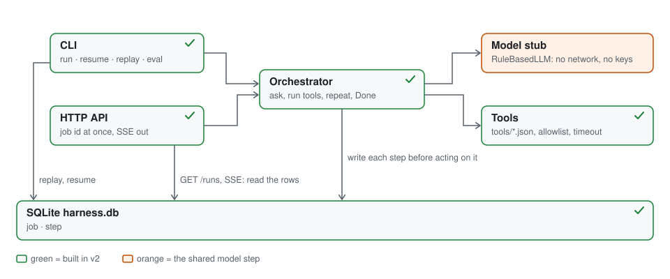

# v2 HLD: keeping it simple

[What v2 is](#what-v2-is) · [The HTTP endpoints](#the-http-endpoints) · [Persistence: SQLite](#persistence-sqlite) · [Streaming the answer: SSE](#streaming-the-answer-sse) · [Builder experience](#builder-experience) · [Try it](#try-it)

The harness as a small service: call it over HTTP, state in one SQLite file, the answer streamed back over Server-Sent Events (SSE). Every output below is pasted from `demo-output.txt`, which `./demo.sh` writes.

## What v2 is



- **CLI**: `run`, `resume`, `replay`, `eval`, as before, over the same file the server uses.
- **HTTP API**: `POST /runs` writes the job row and answers with its id before the loop runs; the answer streams out over SSE.
- **Orchestrator**: ask the model, run the tools it names, record the row, repeat until Done. One new entry point, `start(jobId, question)`, for a job the API already opened.
- **Model stub**: `RuleBasedLLM`, no network, no keys; the shared step a real deployment rate limits.
- **Tools**: `tools/*.json`; the agent's list says which may run and for how long.
- **SQLite `harness.db`**: two tables, `job` and `step`; one file, created on first use.
- **Arrows down**: the loop writes each step before acting on it; the faces read (`GET /runs`, the stream, `replay`, `resume`).

## The HTTP endpoints

| method | path | what it does | returns |
| --- | --- | --- | --- |
| GET | `/agents` | lists the agent files | `200`, a list |
| GET | `/agents/{name}` | one agent file | `200`, the agent; `404` |
| PUT | `/agents/{name}` | writes `agents/{name}.json` from the body | `201` created, `200` changed; `400` unknown tool, missing field, name mismatch |
| GET | `/tools` | lists the tool files | `200`, a list |
| POST | `/runs` | `{"agent","question"}`: job row in, loop on a virtual thread | `202 {"jobId","status":"RUNNING"}`; `400` |
| GET | `/runs/{id}` | the job row, its steps, the answer when DONE | `200`; `404` |
| GET | `/runs/{id}/events` | SSE: the stored steps from `Last-Event-ID`, then live, then `done` | `200 text/event-stream`; `404` |

The server is the JDK's own `com.sun.net.httpserver.HttpServer`, one virtual thread per request, JSON by hand with Jackson, errors as `{"error": "..."}`.

```java
private int startRun(HttpExchange exchange) throws IOException {
    JsonNode body = readJson(exchange);
    String agentName = text(body, "agent");
    String question = text(body, "question");
    Agent agent = findAgent(agentName).orElseThrow(() -> new HttpError(400, "no agent named " + agentName));
    String jobId = store.newRun(agent.name(), question);
    Thread.ofVirtual().name("run-" + jobId).start(() -> runJob(agent, jobId, question));
    return send(exchange, 202, JSON.createObjectNode().put("jobId", jobId).put("status", Job.Status.RUNNING.name()));
}
```

The job row goes in first, the 202 goes out, the loop runs on its own thread; `runJob` builds the Orchestrator the CLI uses and calls `start(jobId, question)`.

Proof, from `demo-output.txt` (`--port 0` picked the port):

```
$ curl -s -X POST http://localhost:59760/runs -d '{"agent":"support","question":"What is the status of order ORD-1?"}'
{
  "jobId" : "r-be37",
  "status" : "RUNNING"
}
(202 came back before the loop ran; one second later the job row says DONE and the steps are there:)
$ curl -s http://localhost:59760/runs/r-be37
{
  "id" : "r-be37",
  "conversationId" : "r-be37",
  "agent" : "support",
  "question" : "What is the status of order ORD-1?",
  "status" : "DONE",
  "createdAt" : 1792029646793,
  "updatedAt" : 1792029646816,
  "steps" : [ {
    "run" : "r-be37",
    "step" : 1,
    "turn" : 1,
    "pass" : 1,
    "kind" : "LLM",
    "request" : "pass 1",
    "response" : "ToolCall[toolName=order_status, input={orderId=ORD-1}]",
    "status" : "OK",
    "ms" : 3,
    "attrs" : {
      "question" : "What is the status of order ORD-1?",
      "tool" : "order_status",
      "orderId" : "ORD-1"
    }
  }, {
    "run" : "r-be37",
    "step" : 2,
    "turn" : 1,
    "pass" : 1,
    "kind" : "TOOL",
    "request" : "order_status {orderId=ORD-1}",
    "response" : "Order ORD-1: SHIPPED, shipment SHP-1",
    "status" : "OK",
    "ms" : 0,
    "attrs" : {
      "tool" : "order_status",
      "orderId" : "ORD-1",
      "key" : "r-be37/1"
    }
  }, {
    "run" : "r-be37",
    "step" : 3,
    "turn" : 1,
    "pass" : 2,
    "kind" : "LLM",
    "request" : "pass 2",
    "response" : "Done[]",
    "status" : "OK",
    "ms" : 0,
    "attrs" : {
      "question" : "What is the status of order ORD-1?"
    }
  } ],
  "answer" : "Order ORD-1: SHIPPED, shipment SHP-1"
}
$ curl -s -X PUT http://localhost:59760/agents/returns -d @- <<< '{"name":"returns","description":"Refunds an order, by order id","tools":["refund_orders"],"maxPasses":3,"toolTimeoutMs":2000}'
{
  "error" : "no tool named refund_orders in tools/"
}
```

- The 202 carried the id before the loop ran; the GET a second later says `DONE`, three steps, the answer.
- The TOOL row's `key`, `r-be37/1`, is job id plus the deciding step: the idempotency key a tool that writes would use.
- A PUT naming a tool that does not exist is refused and writes nothing; the accepted PUT is under Builder experience.

## Persistence: SQLite

```sql
CREATE TABLE IF NOT EXISTS job (
  id TEXT PRIMARY KEY, conversation_id TEXT, agent TEXT, question TEXT,
  status TEXT, created_at INTEGER, updated_at INTEGER);
CREATE TABLE IF NOT EXISTS step (
  job_id TEXT, step INTEGER, turn INTEGER, pass INTEGER, kind TEXT, request TEXT,
  response TEXT, status TEXT, ms INTEGER, attrs TEXT, PRIMARY KEY (job_id, step));
```

- **Why SQLite here**: one file, zero setup, the same two-table shape a real tenant database has; `attrs` is JSON text, so a later step adds keys without a migration.
- **What is written when**: the job row at `POST /runs` (`RUNNING`); one step row before the loop acts on that step; `DONE` or `FAILED` on the job row when the loop ends. A process that dies leaves `RUNNING` and a readable prefix for `resume`.
- **What reads it**: `replay`, `resume`, `GET /runs/{id}` and the event stream, through `SqliteRunStore`. `eval` runs each case on an in-memory store and never touches the file.

| option | how it works | what you get | what it costs |
| --- | --- | --- | --- |
| a file per run (v2 until now) | append one JSON line per step to `runs/<id>.jsonl` | nothing to install; a crash leaves a readable prefix | no job row, no status, nothing to query across runs; a server would scan a folder |
| SQLite, one file | the two tables above in `harness.db`; every write is one `INSERT` or `UPDATE` | one file, zero setup, SQL for status and queries, the same shape a real database has | one writer at a time; the file lives on one machine |
| Postgres | the same two tables on a database server | many API nodes and workers share one truth | something to run and operate |

I pick SQLite because it is the smallest thing with a job row and a query, and the two tables move to Postgres unchanged the day a second machine needs them.

Proof, the file after `./demo.sh`:

```
$ sqlite3 harness.db ".schema"
CREATE TABLE job (
  id TEXT PRIMARY KEY, conversation_id TEXT, agent TEXT, question TEXT,
  status TEXT, created_at INTEGER, updated_at INTEGER);
CREATE TABLE step (
  job_id TEXT, step INTEGER, turn INTEGER, pass INTEGER, kind TEXT, request TEXT,
  response TEXT, status TEXT, ms INTEGER, attrs TEXT, PRIMARY KEY (job_id, step));

$ sqlite3 -header -column harness.db "SELECT id, agent, status, created_at FROM job ORDER BY created_at DESC LIMIT 3"
id      agent    status  created_at   
------  -------  ------  -------------
r-4d64  chaos    DONE    1792029647959
r-be37  support  DONE    1792029646793
r-184b  support  DONE    1792029646174

$ sqlite3 -header -column harness.db "SELECT step, kind, status, ms, attrs FROM step WHERE job_id = 'r-be37'"
step  kind  status  ms  attrs                                                                                    
----  ----  ------  --  -----------------------------------------------------------------------------------------
1     LLM   OK      3   {"question":"What is the status of order ORD-1?","tool":"order_status","orderId":"ORD-1"}
2     TOOL  OK      0   {"tool":"order_status","orderId":"ORD-1","key":"r-be37/1"}                               
3     LLM   OK      0   {"question":"What is the status of order ORD-1?"}
```

- Two tables, nothing else; `r-be37` is the job opened above, `r-4d64` the live one, `r-184b` the CLI's dedupe run: one file, both faces.
- The three step rows are the three events the stream sends below, same numbers, same attrs.

## Streaming the answer: SSE

- **Run id out at once**: `POST /runs` answers `202` with the job id before the first step exists; the stream is a second request.
- **Events are the stored steps**: `id:` is the step number, `event: step`, `data:` the row as JSON, the row `replay` prints.
- **Catch up, then follow**: every stored step after `Last-Event-ID` (or `?after=N`) goes out at once; then the store is polled every 200 ms until the job is `DONE` or `FAILED`, and `event: done` carries the answer before the stream closes.
- **Reconnect replays the tail**: a client back with `Last-Event-ID: 2` gets step 3 and `done`, nothing twice.
- **Disconnect is not cancel**: the loop runs on its own thread and writes to the store; a listener leaving changes nothing, and the next one reads the rows.

| option | how it works | what you get | what it costs |
| --- | --- | --- | --- |
| polling `GET /runs/{id}` | the client asks again and again | nothing new to learn, works through anything | latency equals the poll interval; the whole row set every time |
| SSE | one HTTP response kept open; events with ids; the browser reconnects with `Last-Event-ID` on its own | one-way is all an answer needs; replay from an id is in the protocol | one open connection per listener on the node that holds it (the scaling question, for its own document) |
| WebSocket | a two-way socket after an upgrade | the client can talk back: cancel, a follow-up | a second protocol, no built-in replay, the same open-connection cost |

I pick SSE because the answer flows one way, and the protocol already has the reconnect-with-last-id a step log needs.

```java
while (!stopped) {
    Job job = store.job(id);
    for (Span row : store.load(id, after + 1)) {
        write(out, "id: " + row.step() + "\nevent: step\ndata: " + JSON.writeValueAsString(row) + "\n\n");
        after = row.step();
    }
    out.flush();
    if (job.status() != Job.Status.RUNNING) {
        ObjectNode done = JSON.createObjectNode().put("jobId", id).put("status", job.status().name());
        if (job.status() == Job.Status.DONE) {
            done.put("answer", answer(job, store.load(id)));
        }
        write(out, "event: done\ndata: " + done + "\n\n");
        return 200;
    }
    Thread.sleep(POLL_MS);
}
```

Status is read before rows, so `done` never goes out with a row unsent; `answer` rebuilds the turn from the rows as `resume` does.

Proof:

```
$ curl -sN --max-time 5 http://localhost:59760/runs/r-be37/events
id: 1
event: step
data: {"run":"r-be37","step":1,"turn":1,"pass":1,"kind":"LLM","request":"pass 1","response":"ToolCall[toolName=order_status, input={orderId=ORD-1}]","status":"OK","ms":3,"attrs":{"question":"What is the status of order ORD-1?","tool":"order_status","orderId":"ORD-1"}}

id: 2
event: step
data: {"run":"r-be37","step":2,"turn":1,"pass":1,"kind":"TOOL","request":"order_status {orderId=ORD-1}","response":"Order ORD-1: SHIPPED, shipment SHP-1","status":"OK","ms":0,"attrs":{"tool":"order_status","orderId":"ORD-1","key":"r-be37/1"}}

id: 3
event: step
data: {"run":"r-be37","step":3,"turn":1,"pass":2,"kind":"LLM","request":"pass 2","response":"Done[]","status":"OK","ms":0,"attrs":{"question":"What is the status of order ORD-1?"}}

event: done
data: {"jobId":"r-be37","status":"DONE","answer":"Order ORD-1: SHIPPED, shipment SHP-1"}

(a client that reconnects sends the last id it saw and gets only the tail)
$ curl -sN --max-time 5 -H 'Last-Event-ID: 2' http://localhost:59760/runs/r-be37/events
id: 3
event: step
data: {"run":"r-be37","step":3,"turn":1,"pass":2,"kind":"LLM","request":"pass 2","response":"Done[]","status":"OK","ms":0,"attrs":{"question":"What is the status of order ORD-1?"}}

event: done
data: {"jobId":"r-be37","status":"DONE","answer":"Order ORD-1: SHIPPED, shipment SHP-1"}
```

A live one, the stream opened right after the POST:

```
$ curl -s -X POST http://localhost:59760/runs -d '{"agent":"chaos","question":"Please hang while checking ORD-1"}'
{
  "jobId" : "r-4d64",
  "status" : "RUNNING"
}
$ curl -sN --max-time 5 http://localhost:59760/runs/r-4d64/events
id: 1
event: step
data: {"run":"r-4d64","step":1,"turn":1,"pass":1,"kind":"LLM","request":"pass 1","response":"ToolCall[toolName=hang_forever, input={orderId=ORD-1}]","status":"OK","ms":0,"attrs":{"question":"Please hang while checking ORD-1","tool":"hang_forever","orderId":"ORD-1"}}

id: 2
event: step
data: {"run":"r-4d64","step":2,"turn":1,"pass":1,"kind":"TOOL","request":"hang_forever {orderId=ORD-1}","response":"cut off after 1000 ms","status":"TIMEOUT","ms":1000,"attrs":{"tool":"hang_forever","orderId":"ORD-1","key":"r-4d64/1"}}

id: 3
event: step
data: {"run":"r-4d64","step":3,"turn":1,"pass":2,"kind":"LLM","request":"pass 2","response":"Done[]","status":"OK","ms":0,"attrs":{"question":"Please hang while checking ORD-1"}}

event: done
data: {"jobId":"r-4d64","status":"DONE","answer":"Tool hang_forever TIMEOUT: cut off after 1000 ms"}
```

- Three `step` events, ids 1 to 3, then `done` with the answer; the second stream starts at 3.
- The live stream waited: step 2 is `hang_forever` cut off after 1000 ms, and `curl` held the open response until that row landed.

## Builder experience

- **An agent is a file**: `agents/{name}.json` with `name`, `description`, `tools`, `maxPasses`, `toolTimeoutMs`; the folder is read on every call, so a new file is live at once.
- **`PUT /agents/{name}` writes it**: the body is checked like a file (a missing field is a `400` naming it), every listed tool must exist, the name must match the path; then the file is written and the next `POST /runs` can use it. No code, no restart.
- **A tool is a file whose `type` picks the adapter**: `lookup` (a map keyed by the id in the question), `sleep`, `fail`; tools are read-only over HTTP today, so adding one is adding a file.

Proof:

```
$ curl -s -X PUT http://localhost:59760/agents/returns -d @- <<< '{"name":"returns","description":"Refunds an order, by order id","tools":["refund_order"],"maxPasses":3,"toolTimeoutMs":2000}'
{
  "name" : "returns",
  "description" : "Refunds an order, by order id",
  "tools" : [ "refund_order" ],
  "maxPasses" : 3,
  "toolTimeoutMs" : 2000
}
$ curl -s http://localhost:59760/agents/returns
{
  "name" : "returns",
  "description" : "Refunds an order, by order id",
  "tools" : [ "refund_order" ],
  "maxPasses" : 3,
  "toolTimeoutMs" : 2000
}
$ cat agents/returns.json
{
  "name" : "returns",
  "description" : "Refunds an order, by order id",
  "tools" : [ "refund_order" ],
  "maxPasses" : 3,
  "toolTimeoutMs" : 2000
}
```

- The PUT answers with the agent as stored (`201`), the GET reads it back the same, and the file on disk has the same five fields.
- `refund_order` is a shipped tool no shipped agent lists; `returns` now does. The demo removes the file afterwards, so the shipped set stays at three.

## Try it

From `v2/`, with Java 21+, Maven and curl:

```
mvn -q compile
java -cp "target/classes:target/lib/*" harness.cli.Main serve
curl -s -X POST http://localhost:8080/runs -d '{"agent":"support","question":"What is the status of order ORD-1?"}'
curl -sN http://localhost:8080/runs/<jobId>/events
```

On JDK 24+ put `--enable-native-access=ALL-UNNAMED` after `java`, or the SQLite driver's native load prints a warning; `./demo.sh` from the repo root runs everything here.
